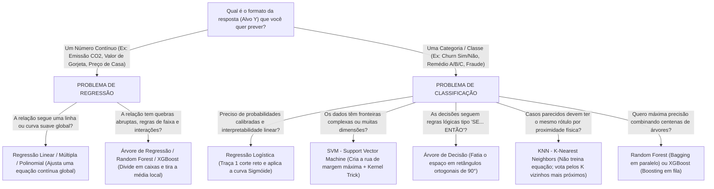
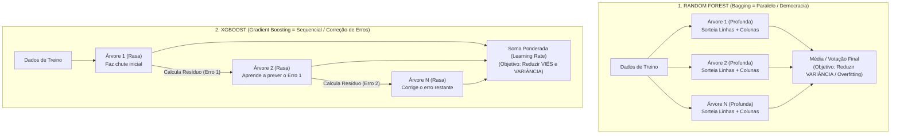

# Guia Mestre: Modelos Clássicos de Machine Learning (IBM AI Engineering)

Este documento foi desenhado como seu **manual definitivo de estudo** para dominar os módulos de Machine Learning Clássico da certificação **IBM AI Engineering**. O foco aqui é eliminar a sensação de que "os modelos parecem todos iguais" — construindo a **intuição geométrica**, a **mecânica real** por trás das equações e a **conexão direta com os 9 notebooks** do seu repositório.

---

## 0. A Bússola Geral: Qual é a Diferença Real Entre os Modelos?

A maior confusão ao estudar Machine Learning vem de ver códigos idênticos no `scikit-learn` (`.fit()`, `.predict()`) sem enxergar **o que muda na geometria de decisão** lá dentro.

Antes de entrarmos em cada modelo, observe a árvore de decisão abaixo para entender **o propósito de cada algoritmo**:



### A Geometria Visual Lado a Lado

Veja abaixo o que acontece quando entregamos **exatamente o mesmo conjunto de dados** para os diferentes modelos de **Classificação** e de **Regressão**:

````carousel

<!-- slide -->

````

> [!IMPORTANT]
> **Repare na diferença visual imediata entre os modelos:**
> 1. **Regressão Logística / SVM Linear:** Só conseguem fazer **um único corte reto** (ou plano) de ponta a ponta.
> 2. **SVM com Kernel RBF:** Dobra o espaço como um lençol elástico, criando **bolhas curvas suaves** ao redor dos grupos.
> 3. **Árvore de Decisão / Regressão:** Só sabe cortar na horizontal e na vertical (**ângulos retos de 90°**). Por isso, na classificação ela cria **caixas retangulares**, e na regressão ela cria **escadas (patamares horizontais)**!
> 4. **KNN ($K$ vizinhos):** Não traça retas nem caixas; cria **fronteiras orgânicas estilo mapa político** baseadas na distância física até os pontos mais próximos.
> 5. **Random Forest / XGBoost:** Somam dezenas de árvores em escada até que os pequenos degraus se aproximem de uma curva refinada e super precisa.

### Tabela Comparativa Definitiva (Para Consulta Rápida)

| Modelo | Tipo de Tarefa | Como "Enxerga" o Mundo | Exige Padronizar Escala (`StandardScaler`)? | Maior Ponto Forte | Maior Ponto Fraco (Calcanhar de Aquiles) | Notebook no seu Repo |
| :--- | :--- | :--- | :--- | :--- | :--- | :--- |
| **Regressão Linear Simples / Múltipla** | Regressão (Número) | Uma reta (2D) ou plano/hiperplano ($N$D) que minimiza a distância vertical ao quadrado até os pontos. | Não obrigatório (a menos que use regularização L1/L2 ou Gradiente Descendente). | Simples, rápido e explica exatamente quanto $Y$ sobe quando $X$ aumenta em 1 unidade. | Fracassa se a relação for curva (não-linear) e é muito sensível a *outliers*. | [Simple-Linear-Regression.ipynb](file:///Users/aluno2/.gemini/antigravity/scratch/ai-engineer-ibm/Simple-Linear-Regression.ipynb) / [Multiple-Linear-Regression.ipynb](file:///Users/aluno2/.gemini/antigravity/scratch/ai-engineer-ibm/Multiple-Linear-Regression.ipynb) |
| **Regressão Logística** | Classificação (0 ou 1 / Probabilidade) | Traça uma fronteira linear e passa o resultado por uma curva em "S" (**Sigmóide**) para gerar probabilidades entre $0\%$ e $100\%$. | **Sim, recomendado** (no `scikit-learn` usa regularização por padrão e converge melhor). | Entrega probabilidades reais e calibradas (ex: "78% de chance de Churn"). | Não separa classes emaranhadas (não-lineares) e sofre no One-vs-Rest com classes intermediárias. | [Logistic-Regression.ipynb](file:///Users/aluno2/.gemini/antigravity/scratch/ai-engineer-ibm/Logistic-Regression.ipynb) / [Multi-Classification.ipynb](file:///Users/aluno2/.gemini/antigravity/scratch/ai-engineer-ibm/Multi-Classification.ipynb) |
| **Árvore de Decisão (Classification Tree)** | Classificação | Faz perguntas binárias (`X > valor?`) fatiando o espaço em caixas retangulares para deixar cada folha "pura" (Gini/Entropia). | **Não!** Árvores olham apenas para a ordem dos valores, nunca para distâncias absolutas. | Altamente visual (fluxograma), lida com dados não-lineares e interações sem esforço. | **Overfitting severo** se crescer sem limite (`max_depth` alto): decora o ruído do treino. | [Decision-Trees.ipynb](file:///Users/aluno2/.gemini/antigravity/scratch/ai-engineer-ibm/Decision-Trees.ipynb) |
| **Árvore de Regressão (Regression Tree)** | Regressão (Número) | Fatia o espaço em caixas retangulares e prevê a **média aritmética** dos pontos que caíram naquela folha (formato de degraus). | **Não!** | Captura relações não-lineares abruptas sem precisar inventar polinômios. | Não sabe extrapolar tendências fora do intervalo de treino e tem alta variância se profunda. | [Regression-Trees.ipynb](file:///Users/aluno2/.gemini/antigravity/scratch/ai-engineer-ibm/Regression-Trees.ipynb) |
| **SVM (Support Vector Machine)** | Classificação (e Regressão) | Encontra o hiperplano que abre a **rua mais larga possível (Margem Máxima)** entre os pontos limítrofes (Vetores de Suporte). | **SIM! Obrigatório.** Margens dependem de distâncias geométricas; escalas grandes dominam o cálculo. | Excelente em altas dimensões (muitas colunas) e capaz de separar curvas complexas via *Kernel Trick*. | Lento para datasets gigantescos (centenas de milhares de linhas) e não dá probabilidade direta sem calibração extra. | [Support-Vector-Machines.ipynb](file:///Users/aluno2/.gemini/antigravity/scratch/ai-engineer-ibm/Support-Vector-Machines.ipynb) |
| **KNN (K-Nearest Neighbors)** | Classificação (e Regressão) | **Não treina modelo!** Guarda os dados e, para cada ponto novo, mede a distância física até os $K$ vizinhos mais próximos e faz votação. | **SIM! Obrigatório.** Se o salário vai de $0$ a $10.000$ e idade de $0$ a $80$, a idade será ignorada na distância. | Zero tempo de treino; adapta-se a qualquer formato geométrico local. | Lento na hora de prever; sofre com a **Maldição da Dimensionalidade** (muitas colunas estragam a distância). | [K-Nearest-Neighbors.ipynb](file:///Users/aluno2/.gemini/antigravity/scratch/ai-engineer-ibm/K-Nearest-Neighbors.ipynb) |
| **Random Forest (Bagging)** | Regressão e Classificação | Cria dezenas/centenas de árvores independentes **em paralelo** (sorteando linhas e colunas) e tira a média/votação. | **Não!** (Baseado em árvores). | Reduz drasticamente o *overfitting* (variância) de uma árvore isolada; muito robusto. | Mais lento e pesado que o XGBoost; perde a leitura simples de uma árvore única. | [Random-Forests-XGBoost.ipynb](file:///Users/aluno2/.gemini/antigravity/scratch/ai-engineer-ibm/Random-Forests-XGBoost.ipynb) |
| **XGBoost (Gradient Boosting)** | Regressão e Classificação | Cria árvores rasas **em fila (sequencialmente)**, onde cada nova árvore é treinada para corrigir o **erro (resíduo)** das árvores anteriores. | **Não!** (Baseado em árvores). | Campeão em performance e velocidade em dados tabulares; reduz viés e variância. | Se mal configurado (muitas árvores + `learning_rate` alto), pode decorar ruído. | [Random-Forests-XGBoost.ipynb](file:///Users/aluno2/.gemini/antigravity/scratch/ai-engineer-ibm/Random-Forests-XGBoost.ipynb) |

---

## 1. O Alicerce (Módulo 1): Ciclo de Vida, Viés vs. Variância e Métricas

Antes de rodar qualquer algoritmo, existem três conceitos transversais que caem em todas as provas da IBM e explicam os resultados dos seus notebooks:

### 1.1 Divisão Treino/Teste e o Pecado Mortal do *Data Leakage* (Vazamento de Dados)

Avaliar um modelo nos mesmos dados em que ele estudou é como entregar a prova com o gabarito anexo: ele tira 10 decorando as respostas, mas fracassa no mundo real. Por isso dividimos os dados com `train_test_split(X, y, test_size=0.2)`.

> [!CAUTION]
> **Pegadinha Clássica de Prova e de Entrevista (*Data Leakage*):**
> Quando você padroniza os dados com `StandardScaler()` (que subtrai a média $\mu$ e divide pelo desvio-padrão $\sigma$), você deve calcular $\mu$ e $\sigma$ **apenas no conjunto de treino** (`scaler.fit_transform(X_train)`) e apenas aplicar essa régua no teste (`scaler.transform(X_test)`). Se você rodar `fit_transform(X)` na tabela inteira **antes** do `train_test_split`, informações estatísticas do futuro (conjunto de teste) vazam para o treino!

### 1.2 O Dilema Fundamental: Viés (*Bias*) vs. Variância (*Variance*)

Todo erro de um modelo de Machine Learning vem de duas forças opostas:

* **Alto Viés (*Bias* $\rightarrow$ *Underfitting* / Subajuste):** O modelo é **simplista ou teimoso demais** para a complexidade do problema. Exemplo: tentar ajustar uma reta rígida em dados que fazem uma curva senoidal, ou criar uma Árvore de Decisão com `max_depth=1`. Ele erra muito tanto no treino quanto no teste.
* **Alta Variância (*Variance* $\rightarrow$ *Overfitting* / Sobreajuste):** O modelo é **flexível e nervoso demais**; ele se contorce para passar exatamente em cima de cada ponto de treino, decorando até os ruídos aleatórios. Exemplo: KNN com $K=1$ ou Árvore de Regressão com `max_depth=12`. Ele tem nota quase perfeita no treino, mas **desmorona no conjunto de teste**.

---

## 2. Modelos Lineares (Módulo 2): Da Reta Contínua à Probabilidade Logística

### 2.1 Regressão Linear Simples
* **Referência no seu repositório:** [Simple-Linear-Regression.ipynb](file:///Users/aluno2/.gemini/antigravity/scratch/ai-engineer-ibm/Simple-Linear-Regression.ipynb)
* **Objetivo:** Prever um valor numérico contínuo ($\hat{y}$, como emissão de $\text{CO}_2$ de um carro em g/km) a partir de **uma única variável explicativa** ($x$, como o tamanho do motor `ENGINESIZE` ou o consumo `FUELCONSUMPTION_COMB`).

#### Como funciona de verdade?
O modelo assume que existe uma relação em linha reta entre $x$ e $y$:

$$\hat{y} = \theta_0 + \theta_1 x$$

Onde:
* $\theta_0$ (**Intercepto / Bias**): O valor base de $\hat{y}$ quando $x = 0$ (onde a reta corta o eixo vertical).
* $\theta_1$ (**Coeficiente / Inclinação / *Slope***): Quanto $\hat{y}$ sobe (se positivo) ou desce (se negativo) para cada aumento de $1$ unidade em $x$.

Para achar a "melhor reta possível" entre infinitas retas, o algoritmo usa o método dos **Mínimos Quadrados Ordinários (OLS — *Ordinary Least Squares*)**: para cada carro $i$, ele mede a distância vertical entre a emissão real ($y_i$) e a emissão prevista na reta ($\hat{y}_i$). Essa diferença $(y_i - \hat{y}_i)$ chama-se **resíduo (erro)**. O modelo escolhe os valores exatos de $\theta_0$ e $\theta_1$ que minimizam a média desses resíduos elevados ao quadrado (**MSE**):

$$\text{MSE} = \frac{1}{n} \sum_{i=1}^{n} (y_i - \hat{y}_i)^2$$

> [!TIP]
> **Por que elevamos o erro ao quadrado no MSE em vez de apenas somar?**
> 1. Se somássemos erros positivos ($+10$) com erros negativos ($-10$), eles se anulariam ($0$), fingindo que o modelo é perfeito!
> 2. Ao elevar ao quadrado, erros grandes são penalizados de forma muito mais severa (errar por $10$ custa $100$; errar por $20$ custa $400$).

#### O que aconteceu no seu Notebook `Simple-Linear-Regression.ipynb`?
No laboratório, você testou dois modelos simples separados para prever `CO2EMISSIONS`:
1. **Modelo 1 usando `ENGINESIZE` (Tamanho do motor):** Gerou a equação $\text{CO}_2 = 125.30 + 39.12 \times \text{ENGINESIZE}$, com $\text{MSE} = 851.05$ e $R^2 = 0.7782$.
2. **Modelo 2 usando `FUELCONSUMPTION_COMB` (Consumo de combustível):** Gerou a equação $\text{CO}_2 = 68.10 + 16.25 \times \text{FUELCONSUMPTION\_COMB}$, com **$\text{MSE} = 772.59$** (erro menor!).

Observe nos gráficos extraídos do seu notebook por que o consumo de combustível teve um MSE menor:

````carousel

<!-- slide -->

````

**Diagnóstico visual dos gráficos acima:** No gráfico de `ENGINESIZE` (Slide 1), os pontos azuis estão muito mais espalhados verticalmente ao redor da reta vermelha (motores do mesmo tamanho podem emitir quantidades diferentes de $\text{CO}_2$ dependendo da eficiência do carro). Já no Slide 2 (`FUELCONSUMPTION_COMB`), a física química fala mais alto: queimar mais litros de combustível gera $\text{CO}_2$ quase diretamente, formando trilhos muito mais colados na reta!

---

### 2.2 Regressão Linear Múltipla e Regressão Polinomial
* **Referência no seu repositório:** [Multiple-Linear-Regression.ipynb](file:///Users/aluno2/.gemini/antigravity/scratch/ai-engineer-ibm/Multiple-Linear-Regression.ipynb)

#### O que muda da Simples para a Múltipla?
Na vida real, um fenômeno raramente depende de uma única variável. Na **Regressão Linear Múltipla**, usamos $m$ variáveis simultaneamente:

$$\hat{y} = \theta_0 + \theta_1 x_1 + \theta_2 x_2 + \dots + \theta_m x_m$$

* **Com 1 variável ($x_1$):** A fronteira de predição é uma **reta** em um gráfico 2D.
* **Com 2 variáveis ($x_1, x_2$):** A predição vira uma **folha plana inclinada (um plano)** em um espaço 3D.
* **Com 3 ou mais variáveis:** Vira um **hiperplano** em um espaço $N$-dimensional.

No seu notebook [Multiple-Linear-Regression.ipynb](file:///Users/aluno2/.gemini/antigravity/scratch/ai-engineer-ibm/Multiple-Linear-Regression.ipynb), quando você combinou `ENGINESIZE`, `CYLINDERS` e `FUELCONSUMPTION_COMB` em um único modelo múltiplo, olhe o salto de qualidade:
* **Regressão Simples (`ENGINESIZE`):** $\text{MSE} = 985.94$ | $R^2 = 0.7616$
* **Regressão Simples (`MPG`):** $\text{MSE} = 776.21$ | $R^2 = 0.8123$
* **Regressão Múltipla (Combinada):** **$\text{MSE} = 466.11$** | **$R^2 = 0.8873$** (quase $89\%$ de toda a variação do $\text{CO}_2$ explicada!).

````carousel

<!-- slide -->

````

> [!NOTE]
> **Por que no Slide 2 acima (`FUELCONSUMPTION_COMB_MPG`) a reta desce da esquerda para a direita ($\theta_1 < 0$) e começa a falhar nas pontas?**
> 1. **Inclinação Negativa:** `MPG` significa *Miles Per Gallon* (milhas por galão — eficiência). Quanto **mais** milhas o carro roda com 1 galão, **mais econômico** ele é e **menos** $\text{CO}_2$ emite! Logo, a correlação é inversa ($\theta_1$ negativo).
> 2. **Onde surge a Regressão Polinomial:** Repare no Slide 2 que os pontos azuis fazem uma **curva (formato de banana/hipérbole)** — carros com `MPG` muito baixo emitem $\text{CO}_2$ muito acima da reta vermelha, e carros com `MPG` alto ficam acima da reta na direita. É exatamente para resolver isso que existe a **Regressão Polinomial**: criamos colunas artificiais elevando $x$ ao quadrado ou ao cubo ($x^2, x^3$) com `PolynomialFeatures()` e passamos para o mesmo `LinearRegression()`. Para o algoritmo, continua sendo uma soma linear de pesos ($\hat{y} = \theta_0 + \theta_1 x + \theta_2 x^2$), mas no gráfico 2D a linha se dobra perfeitamente sobre a curva!

---

### 2.3 Regressão Logística (O Classificador Vestido de Regressão)
* **Referência no seu repositório:** [Logistic-Regression.ipynb](file:///Users/aluno2/.gemini/antigravity/scratch/ai-engineer-ibm/Logistic-Regression.ipynb)

#### A Dúvida Clássica: "Por que se chama Regressão se serve para Classificar?"
Chama-se "Regressão Logística" porque, no primeiro passo interno, ela calcula exatamente a mesma equação linear da Regressão Linear ($z = \theta_0 + \theta_1 x_1 + \theta_2 x_2 + \dots$). Porém, como nosso objetivo não é prever um número livre, e sim **a probabilidade de pertencer à classe 1** (ex: `churn = 1`, cliente vai cancelar a assinatura), não podemos devolver $z$ diretamente.

Veja no gráfico abaixo o desastre que acontece se tentarmos usar a Regressão Linear comum para classificar $0$ e $1$, e como a **Regressão Logística** resolve isso:


1. **Se usarmos uma reta linear (Esquerda):** Para valores altos de $X$, a reta prevê probabilidades de $140\%$ ($1.4$); para valores baixos, prevê $-30\%$ ($-0.3$). Pior: basta aparecer um único cliente extremo (*outlier* lá na direita) para a reta inteira entortar e mudar o limiar de $0.5$, errando clientes normais!
2. **O Segredo da Regressão Logística (Direita — Função Sigmóide):** Ela pega o resultado linear $z = \theta^T x$ e o mergulha na **Função Sigmóide (ou Logística)**:

$$\hat{p} = P(y=1 \mid x) = \sigma(z) = \frac{1}{1 + e^{-z}}$$

* Se $z$ for muito grande e positivo ($z \to +\infty$), $e^{-z} \to 0$, e a probabilidade trava em **$1.0$ ($100\%$)**.
* Se $z$ for muito negativo ($z \to -\infty$), $e^{-z} \to \infty$, e a probabilidade trava em **$0.0$ ($0\%$)**.
* Exatamente onde a combinação linear dá **zero ($z = 0$)**, temos $\sigma(0) = \frac{1}{1 + 1} = \mathbf{0.5}$ (**$50\%$ — a Fronteira de Decisão**!).

#### Como a Regressão Logística aprende? (Por que não usamos MSE aqui?)
Se colocarmos a Sigmóide dentro da fórmula do MSE, a superfície de erro fica cheia de ondulações (não-convexa), fazendo o Gradiente Descendente ficar preso em buracos falsos (mínimos locais). Por isso, a Regressão Logística usa uma função de custo própria chamada **Log Loss (Entropia Cruzada Binária / *Binary Cross-Entropy*)**:

$$\text{Log Loss} = -\frac{1}{n} \sum_{i=1}^{n} \Big[ y_i \log(\hat{p}_i) + (1 - y_i) \log(1 - \hat{p}_i) \Big]$$

**A Intuição da Log Loss:** Ela é um "detector de arrogância errada". Se um cliente **cancelou de verdade ($y=1$)** e seu modelo disse que a chance de cancelar era de apenas $1\%$ ($\hat{p}=0.01$), como $\log(0.01)$ tende a $-\infty$, o modelo leva uma punição gigantesca! **Quanto menor a Log Loss (mais próxima de zero), melhor e mais bem calibrado é o modelo.**

#### Desvendando os Resultados do seu Notebook `Logistic-Regression.ipynb`
No laboratório de Churn de telecomunicações, você analisou o peso de cada variável e testou remover ou adicionar colunas:

````carousel

<!-- slide -->

````

* **Slide 1 (Como ler os coeficientes):** Barras positivas (`equip`, `age`) aumentam $z$, empurrando a probabilidade para a direita da Sigmóide (**mais chance de Churn**). Barras negativas (`tenure` — tempo de casa, `employ`, `address`) diminuem $z$, empurrando para a esquerda (**fidelizam o cliente, menos chance de Churn**).
* **Slide 2 (Por que adicionar mais colunas piorou o modelo?):** Muita gente acha que "quanto mais variáveis, melhor". No seu exercício, adicionar `callcard` e `wireless` fez a Log Loss **subir para $0.7761$ (pior modelo!)**, enquanto **remover `equip` derrubou a Log Loss para $0.5302$ (melhor modelo!)**. Isso acontece porque variáveis ruidosas ou redundantes (multicolinearidade) fazem o modelo ajustar pesos espúrios no treino que erram as probabilidades no conjunto de teste!

---

## 3. Multiclasse e Árvores (Módulo 3): Cortes em Escada, Gini, Entropia e Médias

### 3.1 Classificação Multiclasse: One-vs-Rest (OvR) vs. One-vs-One (OvO)
* **Referência no seu repositório:** [Multi-Classification.ipynb](file:///Users/aluno2/.gemini/antigravity/scratch/ai-engineer-ibm/Multi-Classification.ipynb)

Modelos como a Regressão Logística básica e o SVM nasceram para separar apenas **2 classes** (lado A vs. lado B de uma reta). Mas no seu notebook de obesidade (`NObeyesdad`), existem **$K = 7$ níveis diferentes de peso**! Como transformar um classificador binário em multiclasse? Existem duas estratégias clássicas:

| Característica | One-vs-Rest (OvR) / One-vs-All (OvA) | One-vs-One (OvO) |
| :--- | :--- | :--- |
| **Como funciona** | Treina **1 classificador por classe** contra todas as outras juntas (Ex: "Obesidade Tipo I" vs. "Todas as outras 6 classes misturadas"). | Faz um campeonato de duelos diretos: treina **1 classificador para cada par de classes** (Ex: "Peso Normal vs. Sobrepeso I", ignorando o resto). |
| **Quantos modelos treina ($K$ classes)** | **$K$ modelos** (Para $7$ classes = **$7$ modelos**). | **$\frac{K(K - 1)}{2}$ modelos** (Para $7$ classes = $\frac{7 \times 6}{2} = \mathbf{21}$ **modelos**). |
| **Como decide no final** | Escolhe a classe cujo modelo deu a maior probabilidade/confiança. | Cada um dos $21$ modelos dá 1 voto no seu duelo; vence a classe mais votada. |

#### O Grande Mistério do seu Notebook: Por que o OvO deu $92.2\%$ e o OvR deu apenas $76.12\%$?
No seu laboratório [Multi-Classification.ipynb](file:///Users/aluno2/.gemini/antigravity/scratch/ai-engineer-ibm/Multi-Classification.ipynb), usar exatamente a mesma Regressão Logística com **OvR deu $76.12\%$**, mas mudar para **OvO saltou para $92.20\%$**! Veja na ilustração abaixo o motivo geométrico exato disso:

````carousel

<!-- slide -->

````

> [!IMPORTANT]
> **Entenda a diferença olhando o Slide 1 acima:**
> Os níveis de obesidade têm uma **ordem natural (ordinal)**: *Abaixo do Peso $\rightarrow$ Peso Normal $\rightarrow$ Sobrepeso I $\rightarrow$ Sobrepeso II $\rightarrow$ Obesidade*.
> * Quando o **One-vs-Rest (OvR)** tenta isolar uma classe do meio (ex: *Peso Normal*, em vermelho) contra o "Resto", o grupo "Resto" contém tanto pessoas **mais magras** (na esquerda) quanto pessoas **mais pesadas** (na direita)! Como uma Regressão Logística só sabe traçar **uma única reta**, é geometricamente impossível separar o recheio de um sanduíche das duas fatias de pão com um único corte reto!
> * Já o **One-vs-One (OvO)** só faz duelos entre dois grupos por vez (*Baixo Peso vs. Normal*, depois *Normal vs. Sobrepeso*). Em cada duelo individual, um grupo está sempre à esquerda e o outro à direita — e uma única reta separa os dois com perfeição ($92.2\%$)!

---

### 3.2 Árvores de Decisão para Classificação (*Decision Trees*)
* **Referência no seu repositório:** [Decision-Trees.ipynb](file:///Users/aluno2/.gemini/antigravity/scratch/ai-engineer-ibm/Decision-Trees.ipynb)

#### Como a Árvore é diferente da Regressão Logística?
Esqueça equações globais com pesos somados. Uma **Árvore de Decisão** funciona como um fluxograma médico de perguntas binárias:
1. Começa no **Nó Raiz (*Root Node*)** com todos os pacientes misturados (`DrugA, DrugB, DrugC, DrugX, DrugY`).
2. Faz a pergunta sobre **uma coluna** que melhor separa os grupos: ex. `Na_to_K <= 14.829?`.
3. Se `Verdadeiro`, desce para a esquerda; se `Falso`, vai para a direita (onde já descobre que $100\%$ dos pacientes tomam `DrugY`!).
4. Continua fazendo perguntas nos **Nós Internos** (`BP`, `Age`, `Cholesterol`) até chegar às **Folhas (*Leaf Nodes*)**, que dão o diagnóstico final.

#### A Matemática da Pergunta Perfeita: Impureza de Gini vs. Entropia
Como o algoritmo descobre sozinho que deve perguntar primeiro sobre `Na_to_K <= 14.829` e não sobre `Sex` ou `Age`? Ele testa todos os cortes possíveis e mede o nível de **"bagunça / mistura de classes" (Impureza)** antes e depois do corte usando uma de duas métricas:

1. **Entropia ($H$):** Mede a incerteza termodinâmica/informacional do nó (varia de $0$ a $\log_2 K$):
   $$\text{Entropia}(S) = -\sum_{c=1}^{K} p_c \log_2(p_c)$$
2. **Impureza de Gini:** Mede a probabilidade de sortear um item do nó e errar a classe dele se chutarmos conforme a proporção (varia de $0$ a $1 - \frac{1}{K}$):
   $$\text{Gini}(S) = 1 - \sum_{c=1}^{K} p_c^2$$

* **Nó 100% Puro (todas as amostras da mesma classe, $p_1 = 1$):** $\text{Entropia} = 0$ e $\text{Gini} = 0$. (Objetivo atingido!).
* **Nó 50%/50% Misturado (máxima confusão em 2 classes):** $\text{Entropia} = 1.0$ e $\text{Gini} = 0.5$.

A árvore sempre escolhe o corte que proporciona o maior **Ganho de Informação (*Information Gain*)**, que nada mais é do que o quanto a Entropia (ou Gini) caiu do nó pai para a média ponderada dos nós filhos:

$$\text{Information Gain} = \text{Entropia}(\text{Pai}) - \left( \frac{n_{\text{esq}}}{n_{\text{total}}} \text{Entropia}(\text{Esq}) + \frac{n_{\text{dir}}}{n_{\text{total}}} \text{Entropia}(\text{Dir}) \right)$$

#### Análise dos Gráficos do seu Notebook `Decision-Trees.ipynb`

````carousel

<!-- slide -->

````

Observe no **Slide 1** a árvore que você treinou:
* No topo (`Na_to_K <= 14.829`), `entropy = 1.947`. Quem tem `Na_to_K > 14.829` vai para a direita e cai direto numa folha com **`entropy = 0.0` e `samples = 73`** (todos são `DrugY`!).
* No **Slide 2**, veja por que com `max_depth = 3` a acurácia era de apenas **$81.67\%$**, mas ao permitir `max_depth = 4` ela cravou **$98.33\%$**: no nível 3 de profundidade, os pacientes de pressão normal/baixa ainda estavam misturados entre `DrugC` e `DrugX`; faltava exatamente a 4ª pergunta sobre o Colesterol (`Cholesterol <= 0.5`) para separar `DrugC` de `DrugX` e zerar a entropia!

---

### 3.3 Árvores de Regressão (*Regression Trees*)
* **Referência no seu repositório:** [Regression-Trees.ipynb](file:///Users/aluno2/.gemini/antigravity/scratch/ai-engineer-ibm/Regression-Trees.ipynb)

#### Qual é a diferença entre uma Árvore de Decisão (Classificação) e uma Árvore de Regressão?
Esta é uma das perguntas mais cobradas nos exames da IBM! A estrutura de perguntas (`SE X <= valor`) é idêntica, mas **duas coisas mudam completamente**:

| Elemento | Árvore de Classificação (`DecisionTreeClassifier`) | Árvore de Regressão (`DecisionTreeRegressor`) |
| :--- | :--- | :--- |
| **O que uma Folha responde?** | A **classe majoritária** (votação modal) dos exemplos que caíram naquela folha (ex: `DrugY`). | A **média aritmética simples** ($\bar{y} = \frac{1}{N}\sum y_i$) dos valores numéricos que caíram naquela folha (ex: gorjeta média de $\$3.45$). |
| **Como escolhe o melhor corte?** | Minimiza a impureza categórica (**Entropia** ou **Gini**). | Minimiza o **Erro Quadrático Médio (MSE / Variância)** dos números dentro de cada folha! |

#### O Caso Real de Overfitting no seu Notebook `Regression-Trees.ipynb`
No laboratório de previsão de gorjetas de táxi em Nova York (`tip_amount`), você viu na prática o perigo de deixar uma árvore crescer demais:

````carousel

<!-- slide -->

````

> [!WARNING]
> **Olhe o Slide 2 acima (`Hyperparameter Tuning: Depth vs. Error Analysis`) — A imagem perfeita do Overfitting:**
> * Quando aumentamos `max_depth` de $4$ para $8$ e para $12$, o **erro no teste (MSE) subiu de $24.41$ para $26.88$**, e o **$R^2$ ficou NEGATIVO ($-0.064$)**!
> * **Como um $R^2$ pode ser negativo?!** A fórmula é $R^2 = 1 - \frac{\text{MSE do Modelo}}{\text{Variância dos Dados (Chutar a Média)}}$. Se $R^2 = 0$, seu modelo é tão útil quanto chutar sempre a gorjeta média para todo mundo. Se **$R^2 < 0$**, significa que a árvore com profundidade $12$ criou folhas minúsculas que decoraram passageiros atípicos do treino; quando chegaram passageiros novos no teste, esses chutes extremos erraram **mais feio do que se você simplesmente chutasse a média geral**!

---

## 4. Distância e Margem (Módulo 4): KNN vs. Support Vector Machines (SVM)

### 4.1 K-Nearest Neighbors (KNN — Os $K$ Vizinhos Mais Próximos)
* **Referência no seu repositório:** [K-Nearest-Neighbors.ipynb](file:///Users/aluno2/.gemini/antigravity/scratch/ai-engineer-ibm/K-Nearest-Neighbors.ipynb)

#### O que torna o KNN único entre todos os modelos?
Todos os outros algoritmos que vimos são *Eager Learners* (aprendizes ansiosos): eles gastam tempo no `.fit()` encontrando uma equação ou árvore e depois descartam os dados de treino.
O **KNN é um *Lazy Learner* (Aprendiz Preguiçoso / Baseado em Instâncias)**:
1. No `.fit(X_train, y_train)`, ele simplesmente **guarda a tabela de treino inteira na memória** (não calcula equação nenhuma!).
2. Quando chega um cliente novo no `.predict()`, o KNN pega uma fita métrica matemática (geralmente a **Distância Euclidiana**) e mede a distância física desse cliente novo até **todos os clientes do banco de dados**:
   $$d(p, q) = \sqrt{(p_1 - q_1)^2 + (p_2 - q_2)^2 + \dots + (p_m - q_m)^2}$$
3. Ele seleciona os **$K$ vizinhos mais próximos** e faz uma votação simples: a categoria mais comum entre esses $K$ vizinhos vence!

#### O Efeito do Hiperparâmetro $K$ no seu Notebook `K-Nearest-Neighbors.ipynb`

````carousel

<!-- slide -->

````

Olhe o **Slide 2** acima (`K-Nearest-Neighbors_img3.png`) — ele resume toda a teoria de Viés e Variância do KNN:
* **Quando $K = 1$ (extrema esquerda):** A linha azul (**Acurácia de Treino**) está em **$100\%$ ($1.0$)**, porque o vizinho mais próximo de cada ponto de treino é ele mesmo! Porém, a linha laranja (**Acurácia de Teste**) está lá embaixo ($\sim 30\%$). Isso é **Overfitting puro (Alta Variância)**: o modelo ouve um único vizinho barulhento.
* **Quando $K$ sobe para $K = 38$:** A acurácia de treino cai para um patamar realista, mas a **acurácia de teste sobe até seu pico ($41.0\%$)**, pois consultar um "conselho de 38 vizinhos" filtra clientes atípicos em um dataset muito sobreposto.
* **Se $K$ crescer até o tamanho do dataset ($K \to N$):** O modelo passa a votar sempre na classe mais populosa do dataset inteiro (**Underfitting / Alto Viés**).

---

### 4.2 Support Vector Machines (SVM — Máquinas de Vetores de Suporte)
* **Referência no seu repositório:** [Support-Vector-Machines.ipynb](file:///Users/aluno2/.gemini/antigravity/scratch/ai-engineer-ibm/Support-Vector-Machines.ipynb)

#### Qual é a diferença entre o SVM e a Regressão Logística?
Imagine dois bairros separados por um rio.
* A **Regressão Logística** traça uma linha no meio olhando para a média probabilística de **todos os moradores** dos dois bairros, mesmo os que moram a quilômetros da divisa.
* O **SVM** ignora quem mora longe da divisa e foca exclusivamente nas **casas da beira do rio (os pontos mais difíceis e próximos da fronteira, chamados de Vetores de Suporte)**. O objetivo do SVM é construir uma **avenida (Margem) a mais larga possível** separando essas casas limítrofes!

#### Os 2 Conceitos-Chave do SVM para a Prova:
1. **Parâmetro de Regularização $C$ (*Soft Margin* / Margem Suave):**
   * **$C$ muito alto:** O SVM fica intolerante a erros no treino (margem estreita e rígida $\rightarrow$ risco de *Overfitting*).
   * **$C$ menor:** O SVM aceita que alguns pontos invadam a avenida em troca de conseguir uma avenida muito mais larga e estável no teste (*menor variância*).
2. **O Truque do Kernel (*Kernel Trick* — Linear, Polinomial, RBF/Gaussiano):**
   * E se os pontos da Classe 0 formarem um círculo no centro e a Classe 1 formar um anel ao redor (impossível separar com uma reta em 2D)?
   * O **Kernel Trick** aplica uma função matemática que "empuxa" o centro para cima, **projetando os dados em uma dimensão superior (3D)** onde você consegue passar uma folha plana cortando o centro elevado do anel da base! Quando você olha de cima (em 2D), aquele plano parece uma fronteira circular perfeita!

#### O Estudo de Caso Real: Detecção de Fraude em Cartão de Crédito (`Support-Vector-Machines.ipynb`)

````carousel

<!-- slide -->

````

Este laboratório ensina **três lições de ouro da Engenharia de IA**:

1. **Por que a Acurácia é Inútil em Dados Desbalanceados (Slide 1):** Apenas **$0.173\%$** das transações são fraudes ($99.827\%$ são legítimas). Se você criar um modelo "burro" que responde `"Não é fraude"` para $100\%$ das transações, ele terá **$99.83\%$ de Acurácia**, mas deixará passar **todas as fraudes do banco**! Por isso usamos:
   * `compute_sample_weight('balanced', y_train)`: Faz cada fraude valer centenas de vezes mais peso na função de custo do que uma transação comum.
   * **Métrica ROC-AUC** (Área sob a curva *True Positive Rate* vs. *False Positive Rate*): Mede a capacidade do modelo de dar notas maiores para fraudes do que para transações normais em qualquer limiar ($1.0$ = perfeito; $0.5$ = cara ou coroa).
2. **O Fenômeno Fascinante do Exercício Final (Slide 2):**
   Quando você reduziu o dataset de **29 colunas para apenas as 6 colunas mais correlacionadas**:
   * **A Árvore de Decisão MELHOROU** seu ROC-AUC de **$0.9389 \rightarrow 0.9517$** ($+1.3\%$).
   * **O SVM PIOROU** seu ROC-AUC de **$0.9858 \rightarrow 0.9368$** ($-4.9\%$).
   * **Por que isso aconteceu?** Árvores fazem cortes gulosos coluna por coluna e se distraem facilmente criando folhas espúrias nas 23 colunas menos relevantes (sofreram *overfitting* com 29 colunas). Já o **SVM brilha em espaços de alta dimensão**: ele usou as 29 dimensões combinadas para encontrar um hiperplano global onde as fraudes ficavam muito mais separáveis!

---

## 5. A Elite dos Modelos de Conjunto (Módulo 5): Random Forest vs. XGBoost
* **Referência no seu repositório:** [Random-Forests-XGBoost.ipynb](file:///Users/aluno2/.gemini/antigravity/scratch/ai-engineer-ibm/Random-Forests-XGBoost.ipynb)

Como vimos, uma única Árvore de Decisão profunda sofre de **Alta Variância** (basta mudar um pouco os dados de treino e a árvore inteira muda). A solução foi criar **Modelos de Conjunto (*Ensemble Learning*)**: combinar dezenas ou centenas de árvores.

Mas existem duas filosofias opostas para juntar árvores: **Bagging (Random Forest)** e **Boosting (XGBoost)**. Entenda a diferença estrutural abaixo:



### A Diferença Explicada sem Mistério:

1. **Random Forest (*Bootstrap Aggregating — Bagging*):**
   * Constrói $N$ árvores **de forma totalmente independente e em paralelo** (uma árvore não sabe que a outra existe).
   * Para evitar que todas as árvores fiquem iguais, usa dois truques: sorteia amostras com reposição (*Bootstrap*) e, em cada nó, sorteia apenas um subconjunto de colunas para testar o corte.
   * Cada árvore individual é profunda (baixo viés, alta variância), mas quando tiramos a **média de 100 árvores independentes**, os erros aleatórios para cima e para baixo se cancelam (**reduz a Variância**)!

2. **XGBoost (*eXtreme Gradient Boosting*):**
   * Constrói árvores rasas (*weak learners*, ex: profundidade 3 a 6) **em fila indiana (sequencialmente)**.
   * **Como funciona na prática?** Imagine prever o preço de uma casa que custa $\$500\text{k}$:
     * A **Árvore 1** chuta $\$400\text{k}$. Sobrou um **resíduo (erro)** de $+\$100\text{k}$.
     * A **Árvore 2** **NÃO** tenta prever o preço da casa! Ela é treinada para prever o **erro da Árvore 1** ($+\$100\text{k}$), e acerta $+\$80\text{k}$. Agora a soma dá $\$400\text{k} + \$80\text{k} = \$480\text{k}$ (erro caiu para $+\$20\text{k}$!).
     * A **Árvore 3** é treinada para prever os $+\$20\text{k}$ restantes, e assim sucessivamente, multiplicando cada passo por uma taxa de aprendizado prudente (`learning_rate` $\eta$), além de incluir regularização matemática nos pesos das folhas e processamento otimizado em hardware.

### Os Resultados do seu Notebook `Random-Forests-XGBoost.ipynb` (California Housing)

````carousel

<!-- slide -->

````

Olhe o **Slide 2** acima (`Random-Forests-XGBoost_img2.png`):
* **Mais Preciso:** O XGBoost alcançou **$R^2 = 0.8367$** ($\text{MSE} = 0.2140$) contra **$R^2 = 0.8046$** ($\text{MSE} = 0.2560$) da Random Forest, porque corrigir resíduos sequencialmente reduz o viés onde a Random Forest apenas tira médias.
* **24x Mais Rápido:** Enquanto a Random Forest levou **$16.10\text{ segundos}$** para construir árvores profundas até o fim, o XGBoost treinou em **$0.67\text{ segundos}$** (usa árvores rasas + histogramas de quantis pré-ordenados em C++).

---

## 6. Guia de Sobrevivência para os Quizzes da Certificação IBM (Pegadinhas Clássicas)

Reuni abaixo os **10 pontos exatos** que a IBM usa para formular questões de múltipla escolha nos *Graded Quizzes* dos Módulos 1, 2 e 3 (incluindo os pontos que costumam derrubar notas no Quiz de Regressão Linear e Logística):

1. **"A Regressão Polinomial é um modelo linear ou não-linear?"**
   * **Resposta da IBM:** Embora desenhe uma **curva não-linear** em relação ao dado $x$, matematicamente ela é tratada como um caso especial de **Regressão Linear Múltipla**, porque a equação $\hat{y} = \theta_0 + \theta_1 x + \theta_2 x^2$ continua sendo **linear nos parâmetros/coeficientes ($\theta$)**!
2. **"Qual é a saída direta da Regressão Logística antes de aplicar o limiar (threshold)?"**
   * **Resposta:** Uma **probabilidade contínua limitada entre $0$ e $1$** gerada pela função Sigmóide $\sigma(\theta^T x)$, e **não** o rótulo $0$ ou $1$ diretamente (o rótulo só surge após comparar essa probabilidade com um limiar, como $0.5$).
3. **"Por que não usamos o Erro Quadrático Médio (MSE) para treinar a Regressão Logística?"**
   * **Resposta:** Porque aplicar o MSE sobre a função Sigmóide cria uma função de custo **não-convexa** (cheia de mínimos locais onde o Gradiente Descendente trava). Já a **Log Loss** é garantidamente **convexa** (formato de tigela única), garantindo encontrar o mínimo global.
4. **"O que acontece na Regressão Logística se aumentarmos o limiar de decisão de $0.5$ para $0.8$?"**
   * **Resposta:** O modelo fica **mais conservador/exigente** para dizer "Sim (Classe 1)". Com isso, os Falsos Positivos caem (**a Precisão sobe**), mas os Falsos Negativos aumentam (**o Recall cai**).
5. **"Qual critério uma Árvore de Regressão usa para dividir um nó, já que não existe Entropia ou Gini para números contínuos?"**
   * **Resposta:** Ela escolhe o corte que resulta na maior **redução de variância / redução do MSE** (Erro Quadrático Médio) dentro dos nós filhos, e prevê a **média** dos pontos da folha.
6. **"Se aumentarmos o valor de $K$ no algoritmo KNN (ex: de $K=1$ para $K=50$), o que acontece com o Viés e a Variância?"**
   * **Resposta:** Com $K=1$, temos **Baixo Viés e Alta Variância (Overfitting)**. À medida que $K$ aumenta, a fronteira fica mais suave: **a Variância diminui e o Viés aumenta**.
7. **"Qual é a função dos Vetores de Suporte no SVM?"**
   * **Resposta:** São **exclusivamente os pontos de dados mais próximos do hiperplano de decisão** (na borda da margem). Se você remover qualquer outro ponto do dataset que esteja longe da margem, o hiperplano do SVM **não muda um milímetro**!
8. **"Em problemas multiclasse com $K$ classes, quantos classificadores binários são treinados no One-vs-Rest (OvR) e no One-vs-One (OvO)?"**
   * **Resposta:** OvR treina **$K$ classificadores**; OvO treina **$\frac{K(K-1)}{2}$ classificadores** (ex: para $K=4$ classes, OvR treina $4$ e OvO treina $\frac{4 \times 3}{2} = 6$).
9. **"Qual é a diferença fundamental entre Bagging (Random Forest) e Boosting (XGBoost) quanto ao foco no erro?"**
   * **Resposta:** **Bagging** treina árvores independentes em paralelo com reamostragem (*bootstrap*) para **reduzir a Variância (evitar overfitting)**. **Boosting** treina árvores sequencialmente focando nos erros (resíduos) das anteriores para **reduzir principalmente o Viés** (e também a variância via regularização).
10. **"Quais modelos exigem obrigatoriamente normalização/padronização de escala (`StandardScaler`)?"**
    * **Resposta:** Modelos baseados em **distância ou geometria de margem/gradiente**: **KNN**, **SVM** e **Regressão Logística/Linear com regularização**. Modelos baseados em **Árvores (Decision Tree, Regression Tree, Random Forest, XGBoost) NÃO precisam** de escalonamento de variáveis.
