# Guia Mestre Didático: Como os Modelos de Machine Learning Realmente Funcionam (Sem "Matematiquês")
Esqueça as fórmulas cheias de letras gregas. O segredo para dominar Machine Learning e passar na certificação da IBM **não é saber fazer conta na mão** (quem faz a conta é o computador em uma linha de código), e sim **entender a personalidade de cada modelo**: como ele pensa, que tipo de problema ele resolve e **por que ele foi criado para consertar um defeito do modelo anterior**.
---
## 0. A Escada da Evolução: Por que Existem Tantos Modelos?
A melhor forma de nunca mais confundir um modelo com o outro é entender que eles formam uma **história de evolução**. Cada modelo novo nasceu porque o anterior travava em algum tipo de problema:
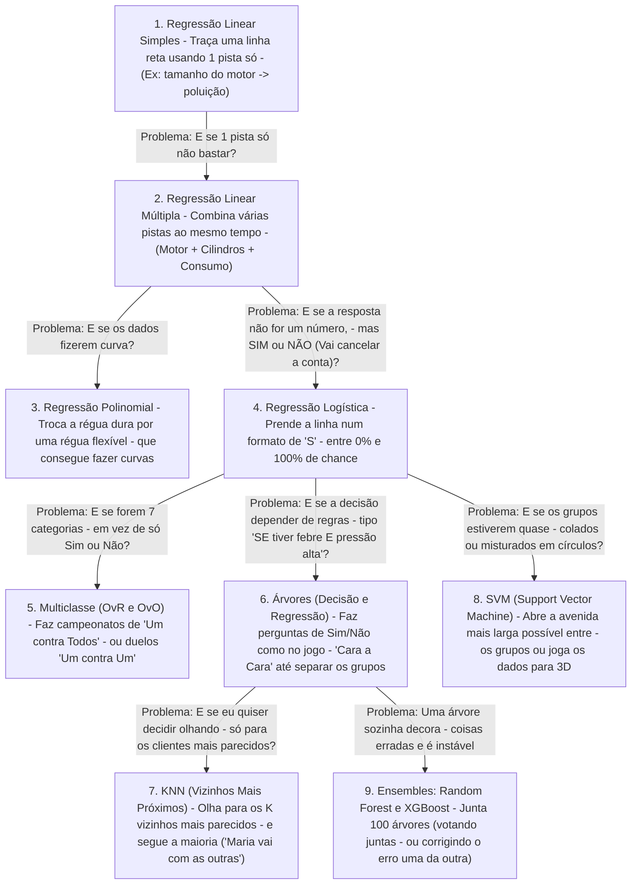
### Enxergando a Personalidade de Cada Modelo numa Única Imagem
Antes de irmos para as histórias de cada um, olhe para as duas figuras abaixo. Nós demos **exatamente os mesmos pontos** para todos os modelos. Veja como cada um tenta resolver o problema de um jeito visualmente único:
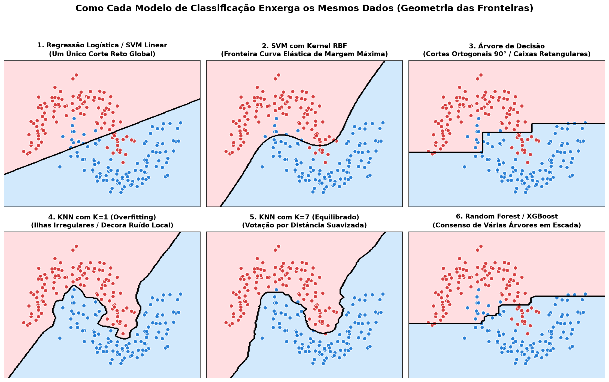

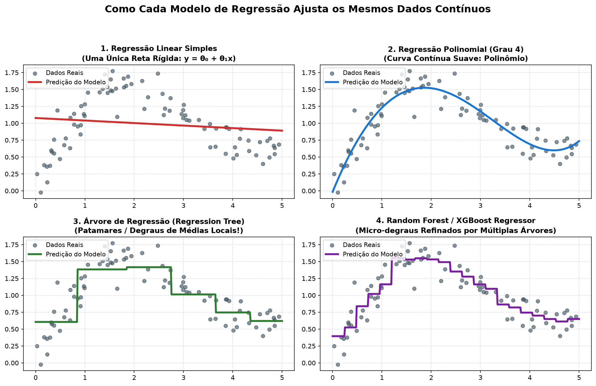
> [!TIP]
> **Guarde essa imagem mental (Slide 1 e Slide 2):**
> * **Modelos Lineares (Regressão Linear / Logística):** São como uma **régua rígida**. Só sabem traçar uma linha reta de ponta a ponta.
> * **SVM com Kernel:** É como um **elástico**. Consegue fazer curvas redondas abraçando um grupo.
> * **Árvores (Decisão / Regressão):** Só sabem cortar na horizontal e na vertical, feito uma **faca cortando um tabuleiro de bolo em quadradinhos**. Por isso, quando preveem números (Slide 2, quadro 3), o gráfico parece uma **escada de degraus retos**!
> * **KNN (Vizinhos):** Cria **ilhas e fronteiras recortadas** como num mapa de países, porque decide ponto a ponto quem mora mais perto.
---
## 1. Os 3 Conceitos que Você Precisa Antes de Começar
Os cursos jogam nomes em inglês como *Overfitting*, *Data Leakage*, *MSE* e *ROC-AUC* sem explicar o que eles significam na vida real. Vamos traduzir:
### 1.1 Treino vs. Teste (O Simulado e a Prova Oficial)
Imagine um professor preparando alunos para o vestibular.
* **Dados de Treino (`X_train`, `y_train`):** São as listas de exercícios com gabarito que o aluno usa em casa para estudar e aprender o padrão.
* **Dados de Teste (`X_test`, `y_test`):** É a prova oficial no dia do vestibular, com questões inéditas que o aluno **nunca viu antes**.
* **Por que dividimos os dados (geralmente 80% treino e 20% teste)?** Porque se você testar o modelo com as mesmas perguntas que ele usou para estudar, você não sabe se ele realmente aprendeu a raciocinar ou se apenas tem boa memória!
### 1.2 *Underfitting* (Subajuste) vs. *Overfitting* (Sobreajuste)
Imagine dois alunos estudando para essa prova:
* **O Aluno Preguiçoso (*Underfitting* / Alto Viés):** Ele só leu o título do livro e criou uma regra boba na cabeça: *"Toda questão que tiver número grande eu marco letra A"*. Ele vai mal no simulado em casa **e** vai mal na prova oficial. **Traduzindo para IA:** É quando você usa um modelo simples demais para um problema difícil (ex: tentar usar uma reta dura para prever algo cheio de curvas).
* **O Aluno "Decoreba" (*Overfitting* / Alta Variância):** Ele não entendeu a matéria, mas decorou que *"no simulado, a questão que começa com a palavra 'Carro' na linha 2 é a letra C, porque tinha uma mancha de café na folha"*. No simulado em casa ele tira **100%**. Mas quando chega na prova oficial (dados de teste) com perguntas novas sem mancha de café, ele tira **zero**! **Traduzindo para IA:** É quando o modelo fica complexo demais e decora até os erros e acidentes dos dados de treino.
### 1.3 Como damos "Nota" para o Modelo? (As Métricas sem Fórmulas)
* **Quando o modelo chuta NÚMEROS (Regressão):**
  * **MAE (Erro Médio Absoluto):** Se o carro emite 200g de $\text{CO}_2$ e o modelo chutou 220g, ele errou por 20g. O MAE é simplesmente a média de quanto o modelo erra para mais ou para menos no dia a dia.
  * **MSE (Erro Quadrático Médio):** Faz a mesma coisa, mas dá um **castigo muito mais pesado para erros grandes**. Se o modelo errar vários carros por pouquinho, tudo bem; mas se errar um carro feio (por 100g), o MSE explode para te avisar que o modelo deu uma fora grave.
  * **$R^2$ (R-Quadrado — Nota de 0 a 1):** Pense nele como a **"porcentagem de explicação"**. Um $R^2$ de `0.88` significa que o seu modelo conseguiu explicar **88%** do motivo pelo qual alguns carros poluem mais que outros! Se der `0.0`, seu modelo não serve para nada (é igual a chutar sempre a média). E se der **negativo** (como acontece num dos seus notebooks!), significa que o seu modelo decorou tanta besteira (*Overfitting*) que está errando mais do que uma pessoa que chuta o valor médio de olhos fechados!
---
## 2. Regressão Linear: Simples, Múltipla e Polinomial
### 2.1 Regressão Linear Simples — "A Régua com Uma Pista Só"
* **Notebook do seu repositório:** [Simple-Linear-Regression.ipynb](./Simple-Linear-Regression.ipynb)
* **Qual é o objetivo?** Adivinhar um **número contínuo** (quanta poluição de $\text{CO}_2$ um carro solta pelo escapamento) olhando para **uma única característica** do carro (por exemplo, o tamanho do motor).
#### Como ela funciona na prática?
Imagine que você colocou num gráfico um pontinho azul para cada carro: na horizontal está o **tamanho do motor** e na vertical está **quanto ele polui**. Você vai ver uma nuvem de pontos subindo (motores maiores poluem mais).
A Regressão Linear Simples pega uma **régua reta** e tenta posicioná-la bem no meio dessa nuvem de pontos, de um jeito que a linha fique o mais perto possível de todos os pontos ao mesmo tempo.
Depois que a linha vermelha está traçada, prever fica ridículo de fácil: chega um carro novo com motor `3.5`. Você acha o `3.5` embaixo, sobe o dedo até encostar na linha vermelha e olha para o lado: *"Pronto, esse carro vai emitir 262 gramas de $\text{CO}_2$!"*
#### O que aconteceu no seu Notebook `Simple-Linear-Regression.ipynb`?
No notebook, o curso pediu para você testar duas pistas diferentes, uma de cada vez, para ver qual adivinhava melhor a poluição do carro:
1. Primeiro você usou o **Tamanho do Motor (`ENGINESIZE`)**.
2. Depois você usou o **Consumo de Combustível (`FUELCONSUMPTION_COMB`)**.
Olhe os dois gráficos que saíram do seu próprio notebook e compare:
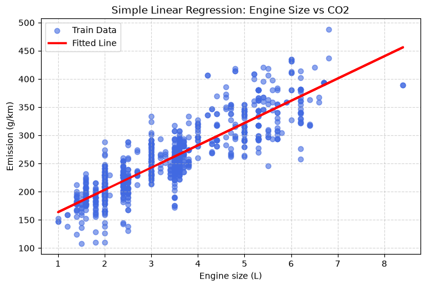

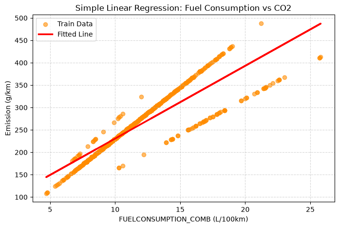
> [!IMPORTANT]
> **Como um professor lê esses dois gráficos com você:**
> * Olhe o **Slide 1 (Tamanho do Motor)**: Tá vendo como os pontos azuis estão bem espalhados, longe da linha vermelha? Isso acontece porque existem motores grandes modernos que são econômicos e motores grandes antigos que bebem muito. O erro (MSE) ficou em **851**.
> * Agora mude para o **Slide 2 (Consumo de Combustível)**: Olhe como os pontos azuis estão **muito mais grudados** na linha vermelha, formando quase trilhos de trem! Por quê? Porque é pura química: queimou mais gasolina, saiu mais fumaça ($\text{CO}_2$). Por estar mais grudado na linha, o modelo erra menos no teste (o erro caiu de 851 para **772**)!
---
### 2.2 Regressão Linear Múltipla e Polinomial — "Juntando Pistas e Dobrando a Régua"
* **Notebook do seu repositório:** [Multiple-Linear-Regression.ipynb](./Multiple-Linear-Regression.ipynb)
#### Qual é a diferença da Simples para a Múltipla?
Imagine um corretor avaliando o preço de um apartamento.
* Se ele usar **Regressão Linear Simples**, ele só pode olhar para **1 coisa**: a metragem ($m^2$). Mas um apartamento de $100m^2$ na favela e um de $100m^2$ de frente para a praia têm preços totalmente diferentes!
* Na **Regressão Linear Múltipla**, o corretor olha para **várias pistas ao mesmo tempo**: Metragem + Número de Quartos + Vagas de Garagem + Bairro. O modelo descobre o "peso" de cada pista (ex: *"Comece em R$ 100 mil, some R$ 5 mil por metro quadrado, some R$ 30 mil por vaga de garagem e tire R$ 2 mil para cada ano de idade do prédio"*).
Foi exatamente isso que você fez no notebook [Multiple-Linear-Regression.ipynb](./Multiple-Linear-Regression.ipynb)! Quando você deu ao modelo 3 pistas juntas (**Tamanho do Motor + Quantidade de Cilindros + Consumo de Combustível**), o erro despencou de **985** para **466** (quase metade do erro!), explicando **88,7%** da poluição dos carros!
#### E quando surge a Regressão Polinomial?
Olhe o gráfico abaixo, que saiu do final do seu notebook de Regressão Múltipla quando você tentou prever a poluição usando a coluna `MPG` (Milhas por Galão — quantos quilômetros o carro faz por litro):
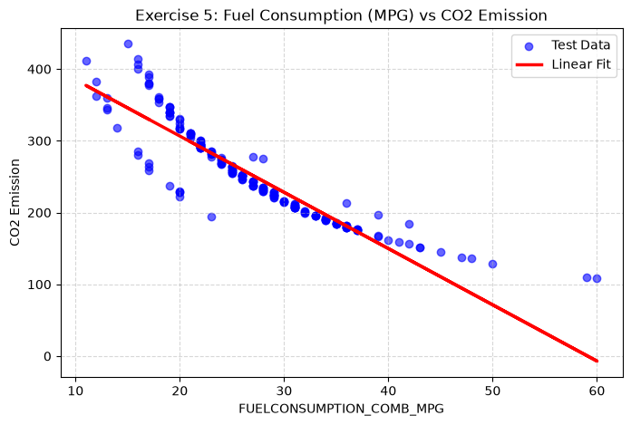
Repare em duas coisas muito legais nesse gráfico:
1. **A linha vermelha está descendo!** Por quê? Porque quanto **mais** quilômetros um carro faz com 1 litro de gasolina (mais econômico), **menos** fumaça ele solta!
2. **Os pontos azuis não seguem uma linha reta — eles fazem uma curva (igual a um escorregador)!** Nas pontas esquerda e direita, os pontos azuis ficam todos para cima da linha vermelha, e no meio ficam para baixo.
   * **A solução:** Quando os dados fazem curva, a Regressão Linear comum fica teimosa tentando passar uma régua reta. A **Regressão Polinomial** é simplesmente dar uma **régua de borracha flexível** para o modelo conseguir acompanhar a curva do escorregador!
---
## 3. Regressão Logística: O Modelo que Diz "Qual é a Chance de Sim ou Não?"
* **Notebook do seu repositório:** [Logistic-Regression.ipynb](./Logistic-Regression.ipynb)
### A Maior Confusão de Todas: "Se o nome é Regressão, por que serve para Classificar?"
Não deixe o nome te enganar! A **Regressão Logística é um modelo de CLASSIFICAÇÃO**.
O objetivo dela **NÃO** é prever quantos reais algo custa, e sim responder uma pergunta de **SIM (1) ou NÃO (0)** calculando a **probabilidade (de 0% a 100%)** daquilo acontecer.
* *Exemplos reais:* "Qual a chance desse cliente cancelar a operadora de celular (*Churn*)?", "Qual a chance desse e-mail ser Spam?", "Qual a chance desse paciente ter um tumor maligno?".
### Por que a Regressão Linear não serve para isso? (Olhe o desenho!)
Imagine que você quer prever se um aluno vai Passar (1) ou Reprovar (0) com base nas horas de estudo. Veja o que acontece se você tentar usar a reta da Regressão Linear contra a curva em "S" da Regressão Logística:
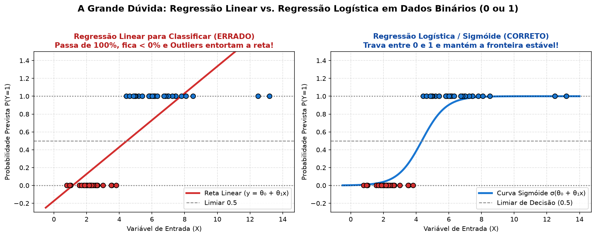
* **Na esquerda (Regressão Linear — ERRADO):** Uma reta não tem teto nem chão! Se o cara estudou 13 horas, a reta diz que ele tem **140% de chance de passar** (o que não existe!). Se estudou pouco, diz que tem **-20% de chance**.
* **Na direita (Regressão Logística — CORRETO):** Ela usa um freio chamado **Curva Sigmóide (formato de "S")**. Não importa quão extremo seja o valor, a curva **nunca passa de 100% (1.0)** no topo e **nunca desce abaixo de 0% (0.0)** no chão!
* **Como ela toma a decisão final?** Ela passa uma linha pontilhada no **meio (50% ou 0.5)**. Se a curva disser que o cliente tem **72% de chance de cancelar**, como passou de 50%, o modelo carimba: **`1 (Vai cancelar)`**. Se der **18%**, carimba: **`0 (Vai ficar)`**.
### O que aconteceu no seu Notebook `Logistic-Regression.ipynb`?
No notebook, você trabalhou para uma empresa de telefonia tentando adivinhar quais clientes iam cancelar o plano (`churn`).
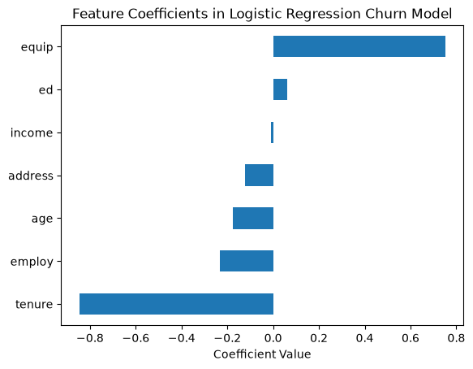

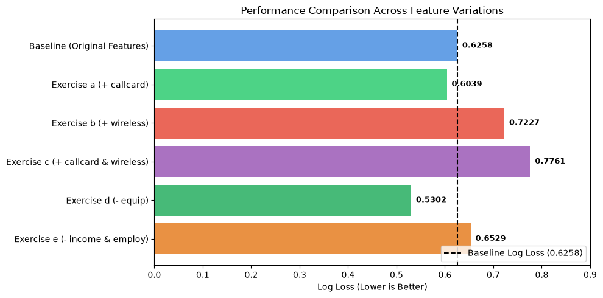
1. **Olhe o Slide 1 (Barras para a direita vs. esquerda):**
   * As barras que apontam para a **esquerda (negativas)**, como `tenure` (tempo que a pessoa já é cliente) e `employ` (anos no emprego), são **âncoras de fidelidade**: quanto mais tempo de casa o cliente tem, **menor** a chance de ele cancelar!
   * Já a barra `equip` apontando forte para a **direita (positiva)** mostra que clientes que alugavam equipamento da operadora estavam cancelando muito mais!
2. **Olhe o Slide 2 (O que é esse tal de *Log Loss* e por que menos colunas foi melhor?):**
   * **O que é *Log Loss*?** É um "medidor de teimosia errada". Se o cliente cancelou, e o seu modelo disse *"Ah, ele tinha 45% de chance de cancelar"*, o modelo errou por pouco e leva uma bronca leve. Mas se o modelo bateu no peito e disse *"Tenho 99,9% de certeza absoluta que ele NÃO vai cancelar!"* e o cara cancela, o *Log Loss* aplica uma **multa pesadíssima**! Por isso, **quanto menor a barra do Log Loss, melhor é o modelo**.
   * **A lição prática do Slide 2:** Quando você colocou colunas extras (`callcard` e `wireless`), a barra ficou vermelha e gigante (`0.776` — pior modelo!). Quando você tirou excessos, a barra ficou verde e curtinha (`0.530` — melhor modelo!). **Moral da história:** Jogar informação inútil ou repetida para dentro do modelo só confunde a cabeça dele na hora da prova!
---
## 4. E Quando Não É Só "Sim ou Não"? (Multiclasse: OvR vs. OvO)
* **Notebook do seu repositório:** [Multi-Classification.ipynb](./Multi-Classification.ipynb)
A Regressão Logística só sabe separar **dois lados** (Sim vs. Não). Mas no seu notebook de saúde, você precisava classificar pacientes em **7 categorias diferentes de peso** (desde *Abaixo do Peso* até *Obesidade Grau III*). Como fazer um modelo que só sabe separar 2 coisas separar 7?
Existem dois jeitos de organizar esse campeonato:
1. **One-vs-Rest (OvR) / One-vs-All (Um contra Todos):**
   * Você cria 7 juízes. O Juiz 1 só pergunta: *"Esse paciente é Peso Normal OU é qualquer outra coisa?"*. O Juiz 2 pergunta: *"Ele é Sobrepeso OU qualquer outra coisa?"*.
2. **One-vs-One (OvO — Duelos Um contra Um):**
   * Em vez de juntar "todo o resto num saco só", você faz duelos diretos de 2 em 2, igual campeonato de futebol: *Baixo Peso vs. Peso Normal*, depois *Peso Normal vs. Sobrepeso*, etc. No final, quem ganhar mais duelos leva o troféu!
### Por que no seu Notebook o "Um contra Um" (92,2%) deu uma surra no "Um contra Todos" (76,1%)?
Essa é uma dúvida que quase todo aluno tem ao rodar o notebook [Multi-Classification.ipynb](./Multi-Classification.ipynb). Olhe o desenho abaixo que fiz especialmente para você enxergar o motivo:
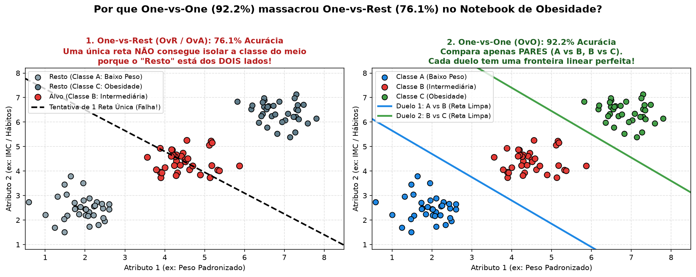

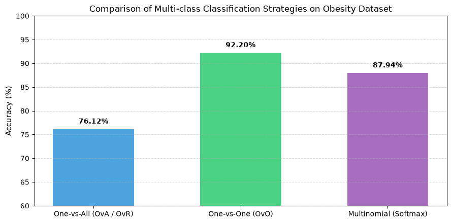
> [!IMPORTANT]
> **A Explicação do Sanduíche (Olhe o quadro esquerdo do Slide 1):**
> Pense em 3 faixas de peso em fila: **Magro (Esquerda)** $\rightarrow$ **Médio (Meio, em vermelho)** $\rightarrow$ **Obeso (Direita)**.
> * Quando o **One-vs-Rest (Um contra Todos)** tenta separar a pessoa de **Peso Médio (vermelho)** de "Todo o Resto (cinza)", olhe onde estão os pontos cinzas: tem gente cinza **mais magra na esquerda** E gente cinza **mais gorda na direita**! O grupo vermelho é o presunto no meio de duas fatias de pão!
> * Agora tente passar **uma única linha reta** que deixe o recheio de um lado e as duas fatias de pão do outro... **É impossível!** Qualquer linha reta que você traçar vai misturar o meio com um dos lados! É por isso que o OvR tirou só **76,1%**.
> * Já no quadro da direita (**One-vs-One**), o duelo é só entre dois vizinhos por vez (*Magro vs. Médio*, depois *Médio vs. Obeso*). Aí uma linha reta passa no meio de cada dupla sem esforço nenhum, acertando **92,2%**!
---
## 5. Árvores de Decisão vs. Árvores de Regressão: O Jogo do "Cara a Cara"
Lembra daquele jogo de tabuleiro da infância, o **Cara a Cara**, onde você tinha que descobrir o personagem do amigo fazendo perguntas de Sim ou Não? (*"Usa chapéu?", "Tem cabelo loiro?", "Usa óculos?"*).
A **Árvore de Decisão** funciona **exatamente assim**!
### 5.1 Árvore de Decisão (Para Classificar Categorias)
* **Notebook do seu repositório:** [Decision-Trees.ipynb](./Decision-Trees.ipynb)
* **Cenário do Notebook:** Um médico precisa decidir qual dos 5 remédios (`Drug A, B, C, X ou Y`) dar para um paciente olhando para Idade, Sexo, Pressão Sanguínea, Colesterol e nível de Sódio/Potássio no sangue (`Na_to_K`).
#### Como a Árvore monta o fluxograma sozinha? (O conceito de "Pureza / Bagunça")
Imagine uma cômoda cheia de meias misturadas de 5 cores diferentes. Isso é o começo da árvore: **alta bagunça (que os cientistas chamam de alta *Entropia* ou alto *Gini*)**.
O objetivo da árvore é fazer perguntas que separem as meias em gavetas onde **cada gaveta tenha uma cor só (100% Pura = Entropia Zero!)**.
Olhe o fluxograma real que o seu próprio notebook desenhou:
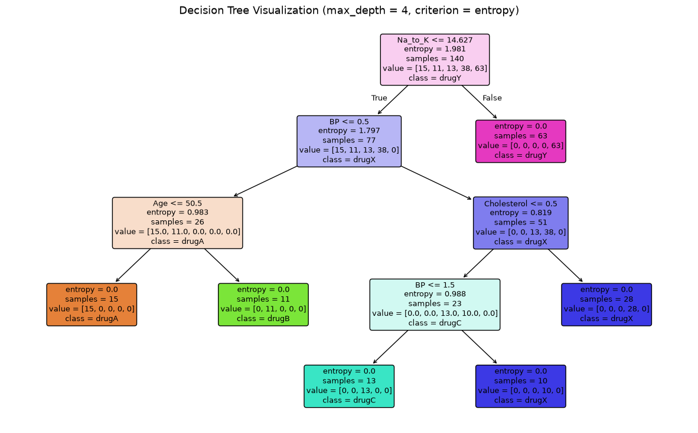

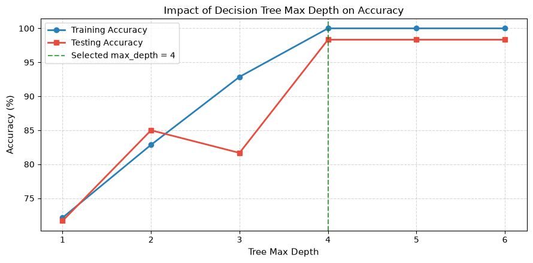
Vamos ler juntos o **Slide 1** de cima para baixo (como um médico lendo um protocolo):
1. **1ª Pergunta (No topo):** *"O nível de Sódio/Potássio (`Na_to_K`) é menor ou igual a 14.8?"*
   * Olhe a seta da **Direita (`False` — Não, é maior que 14.8)**: Caíram 73 pacientes nessa gaveta, e **todos os 73 tomam o Remédio Y**! Acabou a dúvida! (`entropy = 0.0` — gaveta 100% limpa!).
2. **2ª Pergunta (Para quem foi para a esquerda):** *"A Pressão Sanguínea (`BP`) é Alta?"*
   * Quem tem pressão alta vai para a esquerda e a árvore pergunta a **Idade (`Age <= 50.5`)**: se tiver até 50 anos, toma **Remédio A**; se tiver mais de 50 anos, toma **Remédio B**!
3. **E por que no Slide 2 a nota cai de 98,3% para 81,6% se limitarmos a árvore a 3 andares (`max_depth = 3`)?**
   * Porque lá no fundo da árvore (no 4º andar), ainda faltava fazer a pergunta do **Colesterol** para diferenciar quem toma o `Remédio C` de quem toma o `Remédio X`. Se você proíbe a árvore de fazer a 4ª pergunta, ela é obrigada a chutar tudo como `Remédio X` e erra todo mundo que precisava do `Remédio C`!
---
### 5.2 Árvore de Regressão — "O Jogo do Cara a Cara para Adivinhar Números"
* **Notebook do seu repositório:** [Regression-Trees.ipynb](./Regression-Trees.ipynb)
#### Qual é a diferença entre a Árvore de Decisão e a Árvore de Regressão?
Essa pergunta cai direto na prova! A estrutura de perguntas de Sim/Não é igualzinha, mas **o que muda é o que tem dentro da gaveta no final**:
* Na **Árvore de Decisão (Classificação)**, dentro da gaveta final tem categorias (ex: 10 pacientes do Remédio X e 1 do Remédio C $\rightarrow$ vence a maioria: **Remédio X**).
* Na **Árvore de Regressão**, você quer adivinhar um **número** (no seu notebook, **o valor da gorjeta em dólares** que um passageiro vai dar ao taxista em Nova York). Então a árvore faz perguntas (*"A corrida custou mais de 20 dólares? Passou por pedágio?"*), junta todas as corridas parecidas numa mesma gaveta e **tira a média das gorjetas daquela gaveta** (ex: *"As corridas que caem nesta gaveta dão em média US$ 3,50 de gorjeta"*).
#### O Perigo de Fazer Perguntas Demais (*Overfitting* na Prática!)
Olhe o gráfico do seu notebook [Regression-Trees.ipynb](./Regression-Trees_img3.png) quando você deixou a árvore fazer até **12 andares de perguntas (`max_depth = 12`)**:
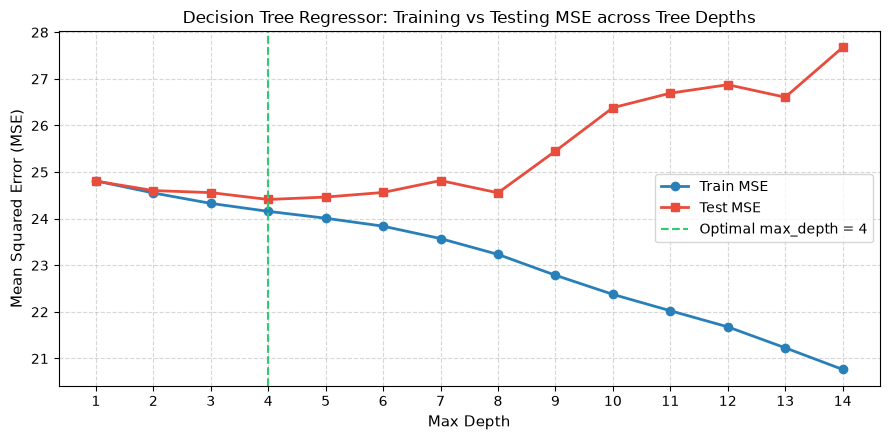
> [!WARNING]
> **Olhe o que aconteceu na direita desse gráfico (`max_depth = 12`):**
> A barra azul (**Erro no Teste**) subiu para o pior nível, e a barra vermelha (**nota $R^2$**) afundou para baixo do zero (**`-0.064` negativo**)!
> **Por que isso aconteceu?**
> Quando você deixa uma árvore fazer 12 perguntas seguidas, ela cria gavetas hiper-específicas com **1 único passageiro dentro**: *"Passageiro que pegou táxi terça-feira às 14h12, rodou 3,4 km, pagou $14,20 e deu uma gorjeta maluca de $50 porque estava bêbado"*. A árvore **decorou a fofoca** do treino! Quando chega um passageiro normal na terça-feira às 14h12 no teste, a árvore chuta que ele vai dar $50 de gorjeta e erra feio! Com apenas **4 andares de perguntas (`max_depth = 4`)**, a árvore faz médias gerais sensatas e acerta muito mais!
---
## 6. KNN (Os Vizinhos Mais Próximos): "Diga-me com Quem Andas..."
* **Notebook do seu repositório:** [K-Nearest-Neighbors.ipynb](./K-Nearest-Neighbors.ipynb)
### Como o KNN é diferente de TODOS os outros modelos?
Todos os outros modelos tentam criar uma "regra geral" (uma linha reta ou uma árvore de perguntas) durante o treinamento.
O **KNN (K-Nearest Neighbors)** é o único modelo que **não cria regra nenhuma antes da hora**! Ele funciona exatamente como você faria se quisesse descobrir o preço de uma casa sem entender de mercado imobiliário:
1. Você olha para a casa que quer avaliar.
2. Você procura na mesma rua as **$K$ casas mais parecidas com ela** (os vizinhos mais próximos).
3. Se você escolheu olhar para **$K = 5$ vizinhos**, e 4 deles pertencem à categoria "Luxo" e 1 pertence à categoria "Econômica", você conclui por maioria: **"Essa casa também é Luxo!"**
### A Regra de Ouro do KNN: Por que você é OBRIGADO a padronizar os números (`StandardScaler`)?
Imagine que o KNN vai medir quão parecido o **Cliente A** é do **Cliente B** usando duas colunas:
* **Idade:** Cliente A tem `20 anos`, Cliente B tem `60 anos` (Diferença = **40**).
* **Salário Anual:** Cliente A ganha `R$ 50.000`, Cliente B ganha `R$ 51.000` (Diferença = **1.000**).
Na vida real, duas pessoas de 20 e 60 anos têm estilos de vida totalmente diferentes, enquanto ganhar 50 mil ou 51 mil por ano é praticamente a mesma coisa!
Mas como o KNN só faz conta de distância bruta, ele acha que `1.000` é muito maior que `40`, então **ele ignora completamente a Idade e decide tudo só pelo Salário**!
É por isso que no KNN (e no SVM) nós sempre passamos o **`StandardScaler`** antes: ele coloca todas as colunas na mesma régua (ex: de -3 a +3), para que a Idade e o Salário tenham o mesmo direito de voto!
### Quantos vizinhos ($K$) eu devo escutar?
Olhe o gráfico que você gerou no seu notebook [K-Nearest-Neighbors.ipynb](./K-Nearest-Neighbors.ipynb) testando desde $K=1$ vizinho até $K=100$ vizinhos:
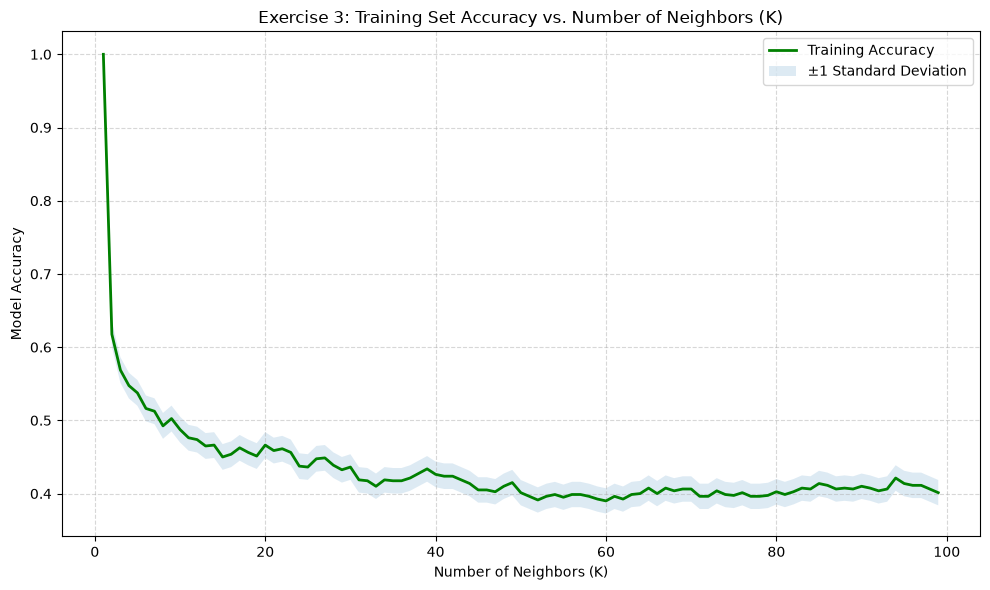
* **Se você escutar só $K = 1$ vizinho (ponta esquerda do gráfico):** Na linha azul (Treino) dá 100%, mas na linha laranja (Teste) dá uma nota péssima (~30%). Por quê? Porque se o único vizinho do lado for um ponto fora da curva (um cara rico que mora num bairro simples), você vai ser enganado por ele!
* **Quando você aumenta para $K = 38$ vizinhos:** A linha laranja (Teste) sobe para o seu melhor resultado (**41%**), porque ao perguntar para uma comissão de 38 vizinhos, a opinião da maioria abafa os vizinhos esquisitos!
---
## 7. SVM (Support Vector Machine): A Avenida Mais Larga e o Lençol Elástico
* **Notebook do seu repositório:** [Support-Vector-Machines.ipynb](./Support-Vector-Machines.ipynb)
### Qual é a diferença entre o SVM e a Regressão Logística?
Tanto a Regressão Logística quanto o SVM básico separam dois grupos passando uma linha divisória. Mas a filosofia deles é totalmente diferente:
* Imagine separar a torcida do **Time A** da torcida do **Time B** num estádio.
* A **Regressão Logística** olha para a posição média de toda a torcida A e de toda a torcida B e passa uma fita no meio.
* O **SVM** é o chefe da tropa de choque: ele não liga para o torcedor que está sentado lá no fundo da arquibancada; ele olha **exclusivamente para os torcedores mais exaltados que estão na primeira fila, quase encostando na outra torcida** (esses pontos da beirada são os famosos **Vetores de Suporte**!). O SVM empurra as duas linhas de frente para criar o **corredor de segurança (Margem) mais largo possível** entre as duas torcidas!
### E o que é o famoso "Truque do Kernel" (*Kernel Trick*) do SVM?
Imagine que em cima de uma mesa você tem **feijões pretos formando uma rodinha no centro**, e **grãos de arroz branco formando um anel em volta** dos feijões.
Tente colocar um lápis reto em cima da mesa para deixar todos os feijões de um lado e todo o arroz do outro... **Não dá!**
O que o **Truque do Kernel** faz? Ele dá um "soco por baixo da toalha da mesa" bem no centro! Os feijões pretos voam para o alto (**3ª dimensão**), enquanto o arroz continua baixo na mesa. Enquanto os feijões estão no ar, o SVM passa uma folha de papel reta cortando o ar entre os feijões lá em cima e o arroz lá embaixo! Simples e genial.
### O Caso de Fraude de Cartão de Crédito no seu Notebook `Support-Vector-Machines.ipynb`
Olhe os dois gráficos que saíram do seu laboratório de detecção de fraude bancária:
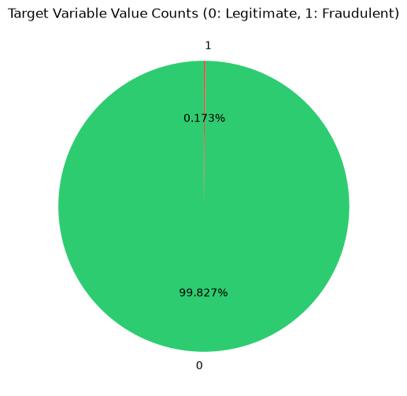

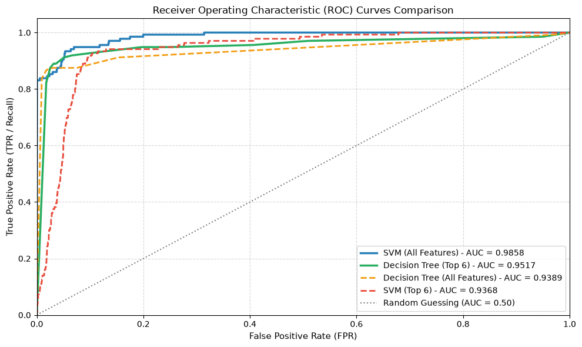
1. **Olhe o Slide 1 (O Perigo da Acurácia Mentilhosa):**
   * De cada 1.000 compras no cartão, **998 são honestas (verde)** e apenas **2 são ladrões (vermelho — 0,173%)**.
   * Se você contratar um segurança preguiçoso que dorme o dia inteiro e diz *"Nenhuma compra é fraude"*, ele vai acertar **99,83% das vezes**! A nota de Acurácia dele será 99,8%, mas o banco vai falir porque ele deixou passar 100% dos ladrões!
   * É por isso que no código aparece `compute_sample_weight('balanced')` (que diz ao modelo: *"Deixar passar 1 ladrão dá uma bronca 500 vezes pior do que incomodar 1 cliente honesto!"*) e avaliamos pela curva **ROC-AUC** (Slide 2), onde o **SVM bateu 0.986** (quase perfeito em separar ladrões de clientes!).
2. **Por que no Slide 2 o SVM foi melhor com todas as 29 pistas (`0.986`), enquanto a Árvore melhorou quando tiramos 23 pistas (`0.952`)?**
   * Porque a Árvore faz uma pergunta por vez e fica confusa quando tem pistas demais (ela cria galhos inúteis). Já o SVM adora ter muitas pistas (29 dimensões) porque fica mais fácil achar espaço para abrir aquela avenida larga entre as compras normais e as fraudes!
---
## 8. Random Forest vs. XGBoost: A Batalha dos Gigantes (Ensembles)
* **Notebook do seu repositório:** [Random-Forests-XGBoost.ipynb](./Random-Forests-XGBoost.ipynb)
Chegamos nos dois modelos mais usados no mercado de trabalho para dados em tabelas.
Ambos usam a mesma matéria-prima: **várias Árvores de Decisão juntas** (porque uma árvore sozinha erra muito quando vê dados novos).
Mas a pergunta de um milhão de dólares da prova é: **Qual é a diferença entre a Random Forest e o XGBoost?**
Imagine que você precisa descobrir o preço exato de uma mansão e decide contratar **100 corretores de imóveis (100 árvores)**:
### 1. Como funciona a Random Forest (*Bagging* — Democracia em Paralelo)
* Você coloca os **100 corretores em 100 salas isoladas ao mesmo tempo**. Ninguém conversa com ninguém.
* Para eles não pensarem igualzinho, você dá para cada corretor uma pasta com fotos um pouco diferentes da casa (uns veem a piscina e a cozinha; outros veem a garagem e a sala).
* Cada corretor dá o seu palpite completo de preço. No final, você simplesmente **calcula a média dos 100 palpites**!
* **Por que funciona?** Se o Corretor 1 exagerou para mais (+R$ 50 mil) e o Corretor 2 exagerou para menos (-R$ 50 mil), na média um exagero anula o outro! O objetivo da Random Forest é **acabar com o nervosismo/exagero (*Overfitting*)** de uma árvore sozinha.
### 2. Como funciona o XGBoost (*Boosting* — Trabalho em Fila Corrigindo Erros)
* Aqui os 100 corretores **NÃO trabalham ao mesmo tempo**. Eles entram na sala **em fila indiana, um depois do outro**!
* A mansão vale **R$ 500 mil**:
  1. O **Corretor 1** entra, dá uma olhada rápida e chuta **R$ 400 mil**. Você anota no quadro negro: *"Faltaram R$ 100 mil para acertar!"*.
  2. O **Corretor 2** entra na sala. A missão dele **NÃO** é avaliar a casa do zero — a missão dele é **olhar só para os R$ 100 mil de erro que o Corretor 1 deixou passar** e descobrir o que faltou olhar (ex: *"Ah, o Corretor 1 esqueceu de olhar que tem piscina, isso soma +R$ 80 mil"*). Agora o palpite da dupla está em **R$ 480 mil** (só faltam R$ 20 mil!).
  3. O **Corretor 3** entra focado exclusivamente em consertar os **R$ 20 mil** que ainda faltam, e assim por diante até o Corretor 100!
### O Resultado desse Duelo no seu Notebook (`Random-Forests-XGBoost.ipynb`)
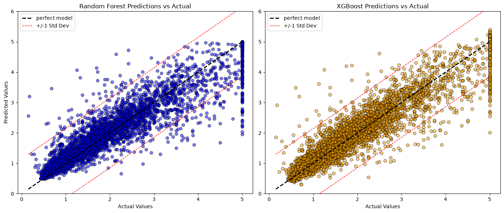

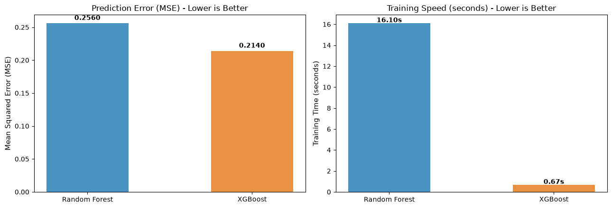
Olhe o placar final no **Slide 2**:
* **Quem acertou mais?** O **XGBoost** tirou nota **$R^2 = 0.837$** (erro de `0.214`), vencendo a **Random Forest** que tirou **$0.805$** (erro de `0.256`). Faz todo sentido: aprender com os erros do colega anterior é mais inteligente do que 100 pessoas chutando no escuro sem conversar!
* **Quem foi mais rápido?** A Random Forest demorou **16 segundos** para treinar, enquanto o XGBoost terminou em **menos de 1 segundo (`0.67s` — 24 vezes mais rápido!)**, porque o XGBoost usa árvores pequenininhas e super rápidas para dar pequenos passos de correção.
---
## 9. Dicionário "Tradutor de Prova" (Para Gabaritar os Quizzes da IBM)
Quando você estiver fazendo os quizzes do curso, eles vão usar frases técnicas. Use esta tabela para traduzir instantaneamente o que a questão está perguntando:
| Quando a questão da prova falar... | Traduza na sua cabeça para... | Qual é a resposta certa para marcar? |
| :--- | :--- | :--- |
| *"O modelo tem alto erro no teste, mas erro quase zero no treino"* | O aluno decorou o simulado com a mancha de café! | **Overfitting (Sobreajuste) / Alta Variância.** Solução: diminuir a profundidade da árvore (`max_depth`), aumentar os vizinhos ($K$) no KNN ou tirar colunas inúteis. |
| *"Qual modelo é um Lazy Learner (aprendiz preguiçoso) / instance-based?"* | Qual modelo não estuda antes da prova e só olha para o lado na hora da pergunta? | **KNN (K-Nearest Neighbors).** Ele só guarda os dados e mede a distância até os vizinhos na hora de prever. |
| *"Qual é a saída da função Sigmóide na Regressão Logística?"* | O que aquela curva em "S" entrega antes de decidirmos Sim ou Não? | Uma **probabilidade entre 0 e 1 (0% e 100%)**. |
| *"Qual critério a Árvore de Decisão usa para escolher qual pergunta fazer primeiro?"* | Como ela escolhe a pergunta que melhor organiza a gaveta de meias? | Reduzir a impureza (**Índice de Gini** ou **Entropia**), buscando o maior **Ganho de Informação (*Information Gain*)**. |
| *"E como a Árvore de Regressão faz para prever um número?"* | O que tem dentro da gaveta final quando queremos prever gorjetas de táxi? | Ela corta os dados para diminuir a diferença entre os números (**MSE / Variância**) e responde com a **média** dos valores que caíram naquela folha. |
| *"Por que o SVM é tão resistente a pontos distantes?"* | Para quem a tropa de choque olha na hora de abrir a avenida entre as torcidas? | Porque ele depende **apenas dos Vetores de Suporte** (os pontos mais próximos da fronteira). Pontos longe da divisa não mudam a linha. |
| *"Para que serve o Kernel Trick no SVM?"* | O soco por baixo da toalha de mesa para separar feijão de arroz! | Para **projetar dados que estão misturados (não-lineares) para uma dimensão mais alta**, onde fica possível separá-los com um corte reto. |
| *"Qual a diferença entre Bagging (Random Forest) e Boosting (XGBoost)?"* | Os 100 corretores em salas separadas vs. em fila indiana! | **Bagging (Random Forest)** treina árvores independentes **em paralelo** e vota para **reduzir a Variância (Overfitting)**. **Boosting (XGBoost)** treina árvores **em sequência**, onde cada uma corrige o **erro (resíduo)** da anterior. |
| *"Em quais modelos eu sou obrigado a usar `StandardScaler` (padronizar escala)?"* | Quem usa fita métrica e se confunde entre Salário (milhares) e Idade (dezenas)? | **KNN e SVM** (e Regressão Logística). **Árvores (Decision Tree, Random Forest, XGBoost) NÃO precisam** disso! |

---

## 🎯 Bússola Rápida para o Exame de Certificação
Sempre que bater dúvida numa questão ou problema prático, faça duas perguntas mentais:
1. **Qual é o formato do Alvo (Y)?**
   - Número contínuo (preço, poluição, gorjeta) → **Regressão**.
   - Categoria ou probabilidade de Sim/Não (churn, fraude, remédio) → **Classificação**.
2. **Qual é a natureza dos Dados?**
   - Relação linear ou proporcional global → **Regressão Linear / Logística**.
   - Regras de corte 'SE... ENTÃO' e dados tabulares com quebras → **Árvores de Decisão / Regressão**.
   - Amostras decididas pela proximidade local → **KNN** (lembre de padronizar a escala!).
   - Fronteiras complexas com foco nos pontos limítrofes → **SVM** (Margem Máxima + Kernel Trick).
   - Máxima performance combinando modelos → **Random Forest** (paralelo) ou **XGBoost** (sequencial).
