# Guia Mestre Completo de Machine Learning (Didático + Técnico — Todos os Métodos do Curso IBM)

Esqueça decorar equações soltas sem entender o porquê. O segredo para dominar Machine Learning na prática (e mandar bem em projetos reais, entrevistas técnicas e provas da IBM) **é combinar duas camadas ao mesmo tempo**:

1. **A Intuição Mecânica:** qual defeito do algoritmo anterior cada novo método nasceu para corrigir, e como ele "pensa" por dentro.
2. **O Rigor Técnico:** quais hiperparâmetros controlam viés vs. variância, quais exigem `StandardScaler`, que função de perda cada um otimiza e onde cada algoritmo quebra em dados reais.

Este guia cobre **todos os 20 notebooks do módulo** — da Regressão Linear Simples até Regularização L1/L2, Clustering (K-Means, DBSCAN, HDBSCAN), Redução de Dimensionalidade (PCA, t-SNE, UMAP), Métricas Avançadas e Engenharia de Pipelines com `ColumnTransformer` + `GridSearchCV`.

---

## 0. Mapa Completo: A Escada da Evolução e Todos os Métodos do Módulo

A melhor forma de nunca confundir algoritmos é enxergar que o Machine Learning clássico se divide em **3 grandes famílias** + **1 camada de engenharia e validação**:

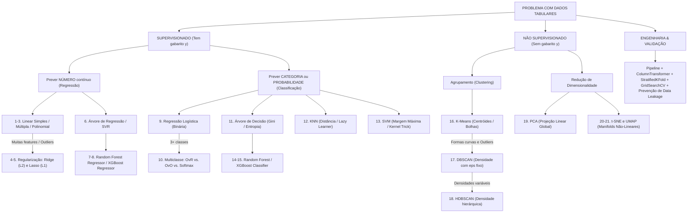

### Inventário Técnico dos 21 Métodos & Técnicas do Curso

| # | Método / Técnica | Tipo | Ideia Central (Como pensa) | Precisa Escalar? | Notebook no Repositório |
| :---: | :--- | :--- | :--- | :---: | :--- |
| **01** | **Regressão Linear Simples** | Regressão | Reta única minimizando erro quadrático (OLS) | Não* | [01-Simple-Linear-Regression.ipynb](./01-Simple-Linear-Regression.ipynb) |
| **02** | **Regressão Linear Múltipla** | Regressão | Combinação linear ponderada de $p$ features | Opcional** | [02-Multiple-Linear-Regression.ipynb](./02-Multiple-Linear-Regression.ipynb) |
| **03** | **Regressão Polinomial** | Regressão | Gera $x^2, x^3, x_1 x_2$ (`PolynomialFeatures`) e ajusta plano linear | Sim | [02-Multiple-Linear-Regression.ipynb](./02-Multiple-Linear-Regression.ipynb) |
| **04** | **Ridge Regression (L2)** | Regressão Regularizada | Encolhe coeficientes grandes ($\alpha \sum w_j^2$); segura colinearidade | **Sim** | [14-Regularization-in-Linear-Regression.ipynb](./14-Regularization-in-Linear-Regression.ipynb) |
| **05** | **Lasso Regression (L1)** | Regressão Regularizada | Penalidade $\alpha \sum \|w_j\|$ que zera pesos inúteis (*Feature Selection*) | **Sim** | [14-Regularization-in-Linear-Regression.ipynb](./14-Regularization-in-Linear-Regression.ipynb) |
| **06** | **Regressão Logística** | Classificação | Passa combinação linear na função Sigmóide $\sigma(z) \in (0,1)$ | **Sim** | [03-Logistic-Regression.ipynb](./03-Logistic-Regression.ipynb) |
| **07** | **OvR, OvO e Multinomial** | Multiclasse | Estratégias para transformar classificadores binários em $K$ classes | **Sim** | [04-Multi-Class-Classification.ipynb](./04-Multi-Class-Classification.ipynb) |
| **08** | **Árvore de Decisão** | Classificação | Cortes ortogonais maximizando Ganho de Informação (Gini / Entropia) | **Não** | [05-Decision-Trees.ipynb](./05-Decision-Trees.ipynb) |
| **09** | **Árvore de Regressão** | Regressão | Cortes via *Midpoints* minimizando MSE / Variância interna nas folhas | **Não** | [06-Regression-Trees.ipynb](./06-Regression-Trees.ipynb) |
| **10** | **SVM / SVR** | Classif. / Regressão | Maximiza margem nos *Vetores de Suporte* + *Kernel Trick* (ou tubo $\varepsilon$) | **Obrigatório** | [07-Support-Vector-Machines.ipynb](./07-Support-Vector-Machines.ipynb) |
| **11** | **KNN (K-Nearest Neighbors)** | Classif. / Regressão | *Lazy learner*: vota pelos $K$ vizinhos mais próximos na hora de prever | **Obrigatório** | [08-K-Nearest-Neighbors.ipynb](./08-K-Nearest-Neighbors.ipynb) |
| **12** | **Random Forest** | Ensemble (Bagging) | Várias árvores paralelas via *Bootstrap* + subconjunto aleatório de features | **Não** | [09](./09-Random-Forests-and-XGBoost.ipynb), [16](./16-Evaluating-Random-Forest.ipynb), [19](./19-Practice-Project-Titanic-Survival.ipynb), [20](./20-Final-Project-Australian-Rainfall-Classifier.ipynb) |
| **13** | **XGBoost** | Ensemble (Boosting) | Árvores rasas sequenciais aprendendo com o gradiente do erro residual | **Não** | [09-Random-Forests-and-XGBoost.ipynb](./09-Random-Forests-and-XGBoost.ipynb) |
| **14** | **K-Means (`k-means++`)** | Clustering | Agrupa em $k$ clusters esféricos minimizando a Inércia até centróides | **Obrigatório** | [10-K-Means-Clustering.ipynb](./10-K-Means-Clustering.ipynb), [17](./17-Evaluating-K-Means-Clustering.ipynb) |
| **15** | **DBSCAN** | Clustering (Densidade) | Conecta regiões densas por raio fixo `eps` e `min_samples`; marca ruído (`-1`) | **Obrigatório** | [11-DBSCAN-and-HDBSCAN-Clustering.ipynb](./11-DBSCAN-and-HDBSCAN-Clustering.ipynb) |
| **16** | **HDBSCAN** | Clustering Hierárquico | Generaliza DBSCAN achando clusters de densidades variadas sem `eps` global | **Obrigatório** | [11-DBSCAN-and-HDBSCAN-Clustering.ipynb](./11-DBSCAN-and-HDBSCAN-Clustering.ipynb) |
| **17** | **PCA** | Redução Linear | Gira eixos ortogonais para concentrar variância (`explained_variance_ratio_`) | **Obrigatório** | [12-Principal-Component-Analysis-PCA.ipynb](./12-Principal-Component-Analysis-PCA.ipynb) |
| **18** | **t-SNE** | Redução Não-Linear | Preserva probabilidades locais de vizinhança para visualizar 2D (`perplexity`) | **Sim** | [13-tSNE-and-UMAP-Dimensionality-Reduction.ipynb](./13-tSNE-and-UMAP-Dimensionality-Reduction.ipynb) |
| **19** | **UMAP** | Redução Topológica | Grafo de *manifolds* rápido, preserva estrutura local + global e aceita `.transform()` | **Sim** | [13-tSNE-and-UMAP-Dimensionality-Reduction.ipynb](./13-tSNE-and-UMAP-Dimensionality-Reduction.ipynb) |
| **20** | **Métricas Avançadas** | Avaliação | Confusion Matrix, Precision/Recall/F1, ROC-AUC, Resíduos, Silhueta, Davies-Bouldin | — | [15](./15-Evaluating-Classification-Models.ipynb), [16](./16-Evaluating-Random-Forest.ipynb), [17](./17-Evaluating-K-Means-Clustering.ipynb) |
| **21** | **Pipelines & Tuning** | Produção / MLOps | `ColumnTransformer`, `Pipeline`, `StratifiedKFold`, `GridSearchCV` anti-*leakage* | Integrado | [18](./18-ML-Pipelines-and-GridSearchCV.ipynb), [19](./19-Practice-Project-Titanic-Survival.ipynb), [20](./20-Final-Project-Australian-Rainfall-Classifier.ipynb) |

> \*Na Regressão Linear Simples com solução analítica (OLS), escalar não muda as previsões, mas muda a magnitude interpretável dos coeficientes. \*\*Em Regressão Linear Múltipla, escalar é recomendado quando você quer comparar o peso relativo (`coef_`) entre variáveis de grandezas distintas.

### Enxergando a Personalidade de Cada Modelo numa Única Imagem

Antes de ir aos detalhes, observe os dois painéis comparativos gerados exatamente sobre os mesmos conjuntos de pontos:

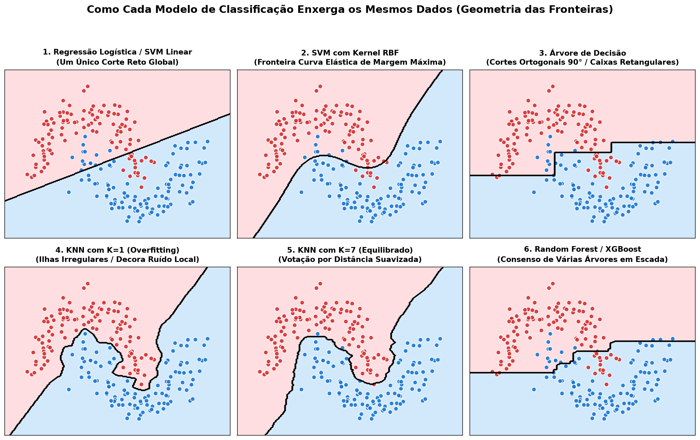

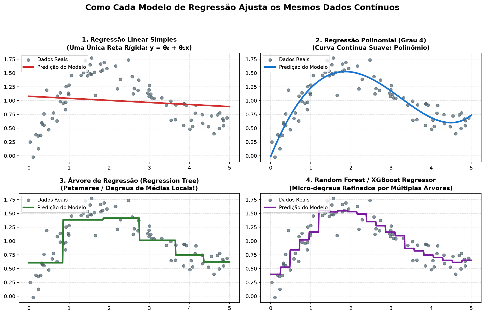

> [!TIP]
> **Guarde essa imagem mental:**
> * **Modelos Lineares (Regressão Linear / Logística):** São como uma **régua rígida**. Só traçam hiperplanos/retas de ponta a ponta.
> * **SVM com Kernel RBF:** É como um **elástico**. Consegue abraçar grupos não-lineares com fronteiras suaves.
> * **Árvores (Decisão / Regressão):** Só cortam em eixos perpendiculares (horizontal e vertical), criando caixas retangulares em classificação e **degraus retos (função em escada)** em regressão.
> * **KNN (Vizinhos):** Cria **ilhas e fronteiras recortadas** como mapa político (diagrama de Voronoi), decidindo ponto a ponto pelos vizinhos locais.

---

## 1. Os 4 Pilares antes de Treinar Qualquer Modelo

### 1.1 Treino vs. Teste e Validação Cruzada
* **Dados de Treino (`X_train`, `y_train`):** são os exercícios com gabarito usados para o algoritmo ajustar pesos (`coef_`), cortes de árvore ou centróides.
* **Dados de Teste (`X_test`, `y_test`):** é a prova final com dados **nunca vistos antes** (tipicamente 20% ou 30%), usada para medir a **generalização real**.
* **Por que dividir com `stratify=y` na classificação?** Se seu dataset tem apenas 23,7% de dias com chuva (ou 0,17% de fraudes), uma divisão puramente aleatória pode jogar proporcionalmente mais ou menos positivos no teste por puro azar. O parâmetro `stratify=y` trava exatamente a mesma proporção de classes no treino e no teste.

### 1.2 *Underfitting* (Alto Viés) vs. *Overfitting* (Alta Variância)
Todo erro total de um modelo em produção pode ser decomposto em:
$$\text{Erro Esperado} = \text{Viés}^2 + \text{Variância} + \text{Ruído Irredutível}$$

* **Underfitting (Alto Viés / Subajuste):** Modelo simples demais (ex: reta linear em dados parabólicos, `max_depth=1`, ou KNN com $K$ muito alto). **Sintoma claro:** erro alto já no **treino** e no **teste**.
* **Overfitting (Alta Variância / Sobreajuste):** Modelo complexo demais (ex: árvore profunda sem poda, polinômio de grau 15, KNN com $K=1$). Ele memoriza até ruído aleatório do treino. **Sintoma claro:** acurácia altíssima no treino (ex: ~100%) seguida de queda forte no teste.

### 1.3 *Data Leakage* (Vazamento de Dados) — O Erro Silencioso Nº 1
Ocorre quando o modelo recebe durante o treinamento qualquer pista que **não existiria no momento da previsão real**. Há duas formas clássicas que você enfrentou no curso:
1. **Leakage de Pré-processamento:** aplicar `StandardScaler().fit_transform(X)`, `SimpleImputer` ou `PCA` no dataset inteiro *antes* de separar `X_train` e `X_test`. Isso faz a média e o desvio padrão do conjunto de teste "vazarem" para o treino (solução obrigatória: **`Pipeline`**).
2. **Leakage Temporal ou de Target:** no projeto final australiano (`20-Final-Project-Australian-Rainfall-Classifier.ipynb`), se você mantiver variáveis coletadas depois do momento da decisão ou confundir a relação temporal entre `RainToday` e `RainTomorrow` ao inverter o alvo, o modelo "cola" do futuro e falha em produção real.

### 1.4 Primeiras Métricas de Regressão
* **MAE (`mean_absolute_error`):** $\frac{1}{n}\sum |y_i - \hat{y}_i|$. Fácil de ler na unidade original (gramas, dólares); trata todos os erros de forma linear.
* **MSE (`mean_squared_error`):** $\frac{1}{n}\sum (y_i - \hat{y}_i)^2$. Penaliza erros grandes ao quadrado — usado como função de custo padrão para otimização.
* **RMSE ($\sqrt{\text{MSE}}$):** Traz a penalidade severa dos erros grandes de volta para a **mesma unidade** do alvo `y`.
* **$R^2$ (`r2_score` — Coeficiente de Determinação):** Mede quanto da variância do alvo o modelo explica em comparação a simplesmente chutar a média $\bar{y}$:
  $$R^2 = 1 - \frac{\sum (y_i - \hat{y}_i)^2}{\sum (y_i - \bar{y})^2}$$
  * `R² = 1.0`: ajuste perfeito.
  * `R² = 0.0`: modelo tão útil quanto chutar sempre a média.
  * `R² < 0`: modelo **pior do que chutar a média** (sinal grave de *overfitting* ou ajuste totalmente errado, como ocorreu no notebook 06!).

---

## 2. Regressão Linear: Simples, Múltipla e Polinomial

### 2.1 Regressão Linear Simples — "A Régua com Uma Pista Só"
* **Notebook:** [01-Simple-Linear-Regression.ipynb](./01-Simple-Linear-Regression.ipynb)
* **Equação:** $\hat{y} = \theta_0 + \theta_1 x$
* **Como calcula:** O algoritmo **OLS (*Ordinary Least Squares*)** escolhe $\theta_0$ (intercepto) e $\theta_1$ (inclinação) que minimizam a soma dos erros quadráticos verticais entre cada ponto real $y_i$ e a reta $\hat{y}_i$.

#### O que aconteceu no Notebook `01`?
Você comparou duas variáveis individuais para prever emissões de $\text{CO}_2$: `ENGINESIZE` (Tamanho do Motor) vs. `FUELCONSUMPTION_COMB` (Consumo Combinado):

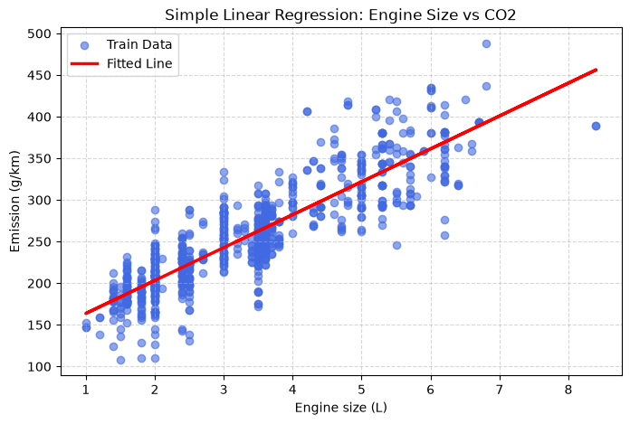

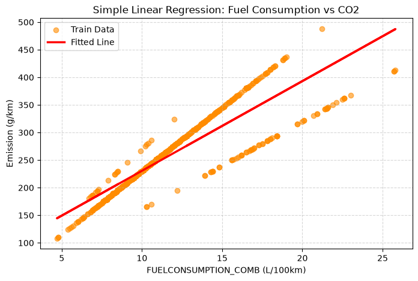

> [!IMPORTANT]
> **Leitura técnica dos gráficos:**
> * No **Slide 1 (`ENGINESIZE`)**, há alta dispersão vertical para o mesmo tamanho de motor (motores grandes modernos eficientes vs. antigos menos eficientes) — MSE de teste ficou em **851**.
> * No **Slide 2 (`FUELCONSUMPTION_COMB`)**, a relação física/química entre litros queimados e $\text{CO}_2$ emitido é quase determinística dentro do tipo de combustível: os pontos formam trilhos estreitos e o MSE caiu de 851 para **772**.

---

### 2.2 Regressão Linear Múltipla e Polinomial — "Juntando Pistas e Dobrando a Régua"
* **Notebook:** [02-Multiple-Linear-Regression.ipynb](./02-Multiple-Linear-Regression.ipynb)
* **Regressão Múltipla:** $\hat{y} = \theta_0 + \theta_1 x_1 + \theta_2 x_2 + \dots + \theta_p x_p$. Cada $\theta_j$ estima quanto `y` muda quando $x_j$ aumenta 1 unidade **mantendo todas as outras variáveis constantes** (*ceteris paribus*).
  * No Notebook `02`, ao combinar `ENGINESIZE`, `CYLINDERS` e `FUELCONSUMPTION_COMB`, o MSE despencou de **985** para **466**, atingindo **$R^2 \approx 0.887$** (88,7% da variância explicada).
* **Quando surge a Regressão Polinomial (`PolynomialFeatures`):**

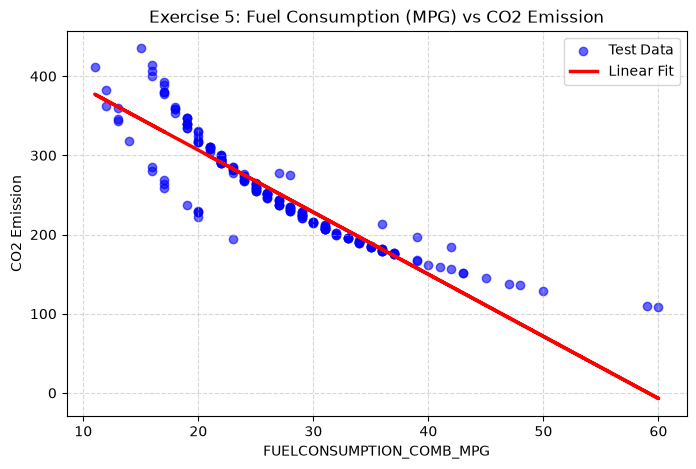

Quando você plotou `MPG` (milhas por galão) vs. emissão de $\text{CO}_2$, a relação real formava uma curva hiperbólica (quanto menor o MPG, muito maior o consumo por km). Uma linha reta sistematicamente erra nas extremidades e no meio.
* **Como a Regressão Polinomial resolve mantendo a matemática linear nos parâmetros?** O `PolynomialFeatures(degree=d)` cria novas colunas artificiais ($x^2, x^3, x_1 \cdot x_2$) e entrega essa tabela expandida para o próprio `LinearRegression`! Por isso ela ainda é chamada de *modelo linear nos coeficientes $\theta$*, embora desenhe curvas suaves no espaço original $X$.
* **Cuidado:** grau polinomial alto (`degree=10+`) explode o número de colunas e produz curvas oscilantes absurdamente sensíveis a ruído (**Overfitting clássico**, conhecido como *fenômeno de Runge*).

---

## 3. Regressão Logística: Probabilidades entre 0% e 100%

* **Notebook:** [03-Logistic-Regression.ipynb](./03-Logistic-Regression.ipynb)
* **Objetivo:** Classificação binária ($y \in \{0, 1\}$), entregando a probabilidade $P(y=1 \mid x) \in (0, 1)$.

### Por que Regressão Linear falha aqui e entra a Curva Sigmóide?

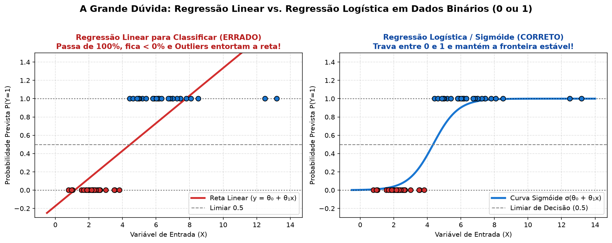

1. A reta linear não é limitada entre 0 e 1 (prevê `-20%` ou `140%` de probabilidade).
2. A **Regressão Logística** aplica a **Função Sigmóide (Logística)** sobre a combinação linear $z = \theta_0 + \theta^T x$:
   $$\hat{p} = \sigma(z) = \frac{1}{1 + e^{-z}}$$
   * Se $z \to +\infty$, $\hat{p} \to 1$. Se $z \to -\infty$, $\hat{p} \to 0$. Se $z = 0$, $\hat{p} = 0.5$ (**limiar de decisão padrão**).
3. **Função de Custo — Por que ela usa *Log Loss* (Entropia Cruzada Binária) e não MSE?**
   Com Sigmóide dentro do MSE, a curva de erro vira não-convexa (cheia de vales falsos). O **Log Loss** torna o problema **convexo** (garantia de mínimo global único) e pune exponencialmente previsões erradas dadas com alta confiança:
   $$\text{LogLoss} = -\frac{1}{N} \sum_{i=1}^N \left[ y_i \log(\hat{p}_i) + (1 - y_i)\log(1 - \hat{p}_i) \right]$$

### O que o Notebook `03` (Telco Churn) mostrou na prática?

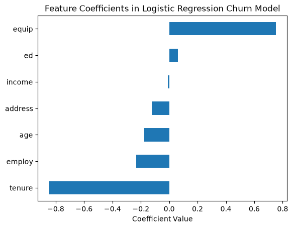

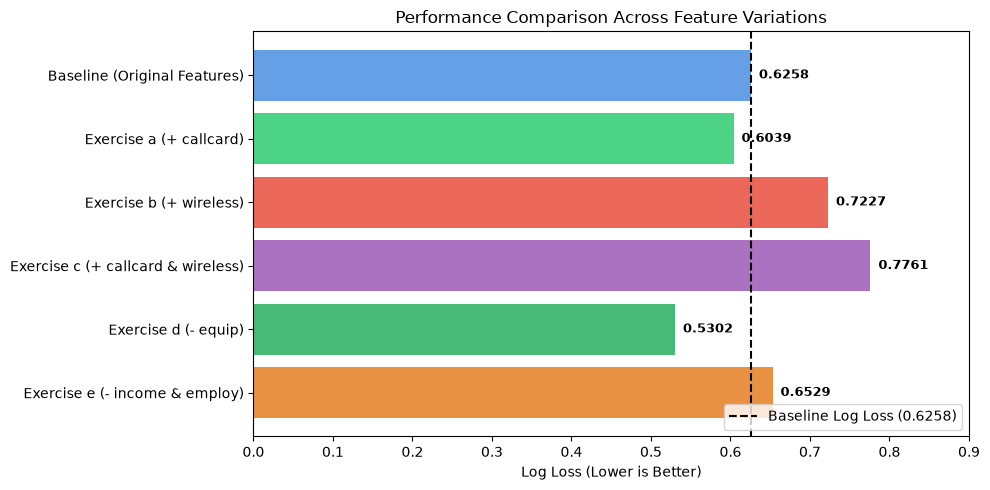

* **Pesos (`coef_`) como direção de risco:** `tenure` (tempo de casa) e `employ` têm coeficientes negativos (empurram probabilidade para `0` = retenção); `equip` tem coeficiente positivo forte (aumenta chance de *churn*).
* **Feature Selection reduzindo Log Loss:** adicionar variáveis redundantes/pouco informativas (`callcard`, `wireless`) subiu o *Log Loss* para **0.776**, enquanto um subconjunto limpo reduziu para **0.530** — provando que menos ruído melhora calibração de probabilidade em modelos lineares.

---

## 4. Classificação Multiclasse: OvR vs. OvO vs. Softmax

* **Notebook:** [04-Multi-Class-Classification.ipynb](./04-Multi-Class-Classification.ipynb) (7 classes de obesidade)

Quando $K > 2$, um classificador binário como `LogisticRegression` precisa de uma estratégia de extensão:

1. **One-vs-Rest (OvR / One-vs-All):** Treina **$K$ classificadores binários** — cada um separa "Classe $i$ contra todas as outras $(K-1)$ juntas". Na previsão, escolhe a classe com maior probabilidade/score.
2. **One-vs-One (OvO):** Treina **$\frac{K(K-1)}{2}$ classificadores binários** — um duelo direto para cada par de classes (para 7 classes, são $\frac{7 \times 6}{2} = 21$ classificadores!). Cada duelo dá 1 voto; em caso de empate, vence quem acumular maior soma ponderada de probabilidades (*Probability Weighing*).
3. **Multinomial (Softmax):** Treina todos os $K$ vetores de peso simultaneamente com **Entropia Cruzada Categórica**, garantindo que $\sum_{k=1}^K \hat{p}_k = 1$.

### Por que no Notebook `04` o OvO (`92,2%`) bateu o OvR (`76,1%`)?

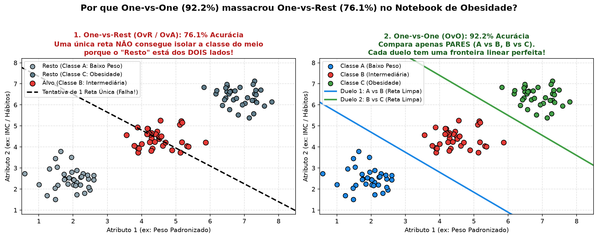

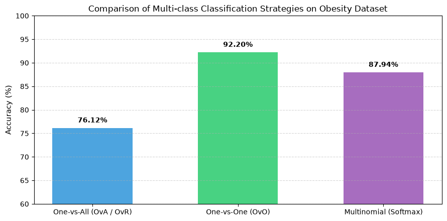

Classes ordinais intermediárias (como *Peso Normal* ou *Sobrepeso I* entre *Baixo Peso* e *Obesidade III*) formam um **"sanduíche" geométrico**: quando o OvR agrupa extremos opostos num único grupo "Resto", nenhuma reta linear consegue isolar o recheio central sem invadir as fatias. Já o OvO só compara pares vizinhos por vez, tornando cada duelo linearmente separável!

---

## 5. Árvores de Decisão e Árvores de Regressão

### 5.1 Árvore de Decisão (Classificação)
* **Notebook:** [05-Decision-Trees.ipynb](./05-Decision-Trees.ipynb) (prescrição de 5 fármacos: `Drug A, B, C, X, Y`)
* **Como ela escolhe cada pergunta?** Em cada nó, o algoritmo CART testa cortes nos atributos e escolhe o split que gera o maior **Ganho de Informação** (maior redução de impureza):
  * **Entropia de Shannon:** $H(S) = -\sum p_i \log_2(p_i)$ — vai de `0` (nó 100% puro, só uma classe) até $\log_2(K)$ (classes perfeitamente misturadas).
  * **Índice de Gini:** $G(S) = 1 - \sum p_i^2$ — padrão rápido do `scikit-learn` (evita logaritmos), medindo a probabilidade de classificar errado um item escolhido ao acaso.

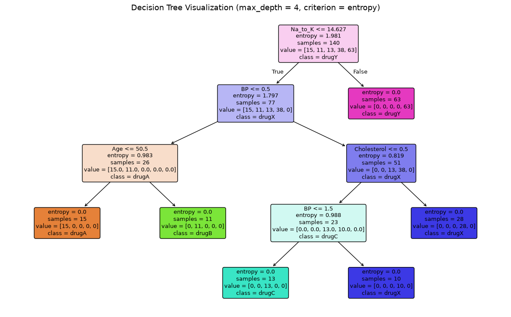

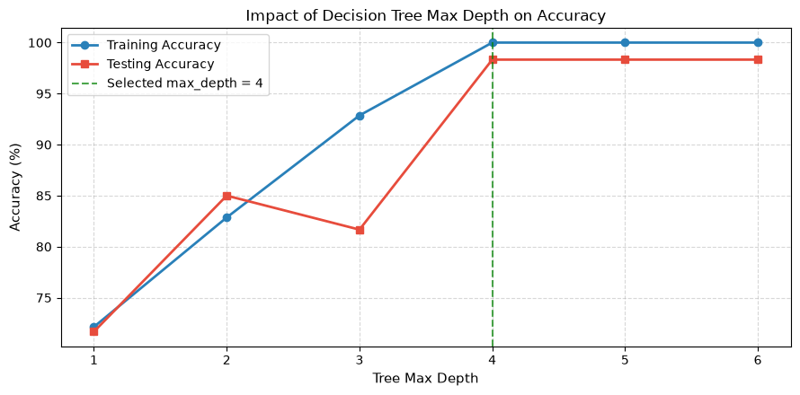

* **Hiperparâmetros de controle (Poda Prévia / *Pre-pruning*):** `max_depth`, `min_samples_split`, `min_samples_leaf`. No Slide 2, limitar `max_depth=3` cortou o galho final que diferenciava `Drug C` de `Drug X` por Colesterol, derrubando a acurácia de **98,3% para 81,6%** (*underfitting*).

### 5.2 Árvore de Regressão (Números Contínuos)
* **Notebook:** [06-Regression-Trees.ipynb](./06-Regression-Trees.ipynb) (previsão de gorjeta de táxi em NY)
* **Como funciona por dentro:**
  1. Para colunas numéricas contínuas, ordena os valores únicos e gera limiares candidatos via **Método dos Pontos Médios (*Midpoints Method*)**.
  2. Avalia qual corte mais reduz a **Variância / MSE ponderado** entre os filhos esquerdo e direito.
  3. Na folha final, prevê a **média aritmética** dos valores de treino que caíram ali (gerando gráfico em degraus).
* **Armadilha crítica (Overfitting severo):** deixar `max_depth=12` criou folhas minúsculas memorizando anomalias do treino — fazendo o **$R^2$ de teste afundar para `-0.064`** (pior que chutar a média!), enquanto `max_depth=4` generalizou muito melhor:

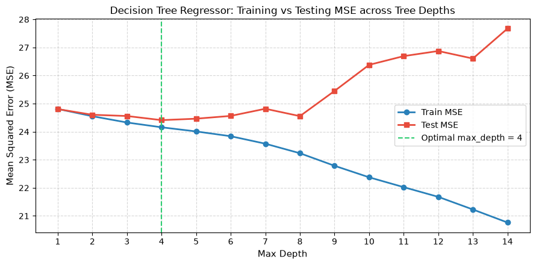

---

## 6. KNN (*K-Nearest Neighbors*) — Aprendiz Preguiçoso

* **Notebook:** [08-K-Nearest-Neighbors.ipynb](./08-K-Nearest-Neighbors.ipynb)
* **Filosofia (*Instance-Based / Lazy Learner*):** Não aprende pesos nem regras no `.fit()`. Apenas indexa os pontos de treino. Na hora do `.predict(x)`, calcula a distância (geralmente Euclidiana, $p=2$) entre $x$ e todos os registros guardados, escolhe os **$K$ vizinhos mais próximos** e faz votação por maioria (classificação) ou média (regressão).
* **Exigência obrigatória de `StandardScaler`:** Distâncias geométricas são destruídas se uma coluna varia de `0` a `100.000` (salário) e outra de `0` a `80` (idade). Sem padronização ($z = \frac{x - \mu}{\sigma}$), a variável de maior escala domina 100% da distância.
* **Efeito do hiperparâmetro $K$:**
  * **$K$ muito pequeno ($K=1$):** fronteira hiper-recortada, sensível a qualquer ruído $\rightarrow$ **Overfitting (Alta Variância)**.
  * **$K$ muito grande:** consulta quase o dataset inteiro e devolve apenas a classe majoritária global $\rightarrow$ **Underfitting (Alto Viés)**.

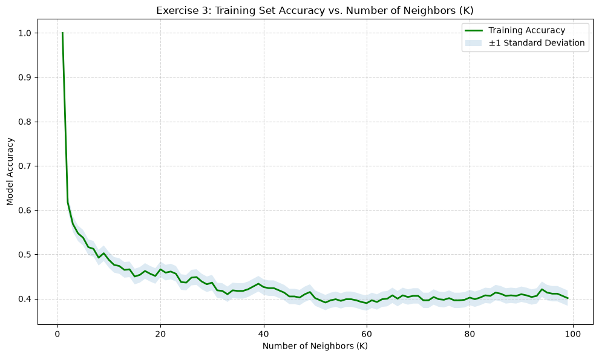

---

## 7. SVM & SVR: Margem Máxima e o Truque do Kernel

* **Notebook:** [07-Support-Vector-Machines.ipynb](./07-Support-Vector-Machines.ipynb) (detecção de fraude de cartão de crédito com apenas **0,173%** de positivos)
* **Diferença estrutural para a Regressão Logística:** Enquanto a Logística usa todos os pontos para ajustar probabilidades, o **SVM Linear** busca o hiperplano que **maximiza a largura da avenida (margem)** apoiando-se exclusivamente nos pontos mais próximos da divisa (**Vetores de Suporte**). Isso o torna muito resistente a pontos distantes bem classificados.
* **Hiperparâmetro `C` (Margem Suave):** controla a punição para violações da margem (`C` alto = margem estreita, menos tolerância a erro no treino, risco de *overfitting*; `C` baixo = margem larga, mais tolerante a ruído).
* **Kernel Trick (`kernel='rbf' | 'poly'`):** Quando as classes são inseparáveis no plano 2D (ex: anéis concêntricos), a função Kernel calcula produtos escalares em um espaço de dimensão superior **sem precisar computar explicitamente as coordenadas expandidas**, permitindo que um corte linear na dimensão alta vire uma fronteira circular/elástica no 2D.
* **SVR (Support Vector Regression):** em vez de minimizar erro de qualquer ponto fora da linha, cria um **"tubo" de tolerância de largura $\varepsilon$ (*epsilon*)**. Pontos dentro da banda $\pm\varepsilon$ têm perda zero; apenas pontos fora da faixa sofrem penalidade linear e viram vetores de suporte. (Reduzir $\varepsilon$ estreita a faixa e deixa mais pontos fora dela!)

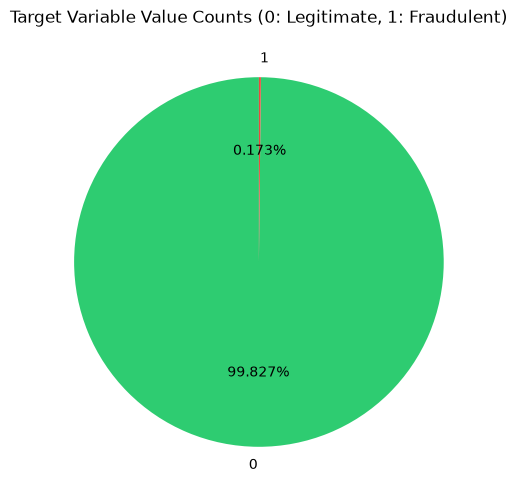

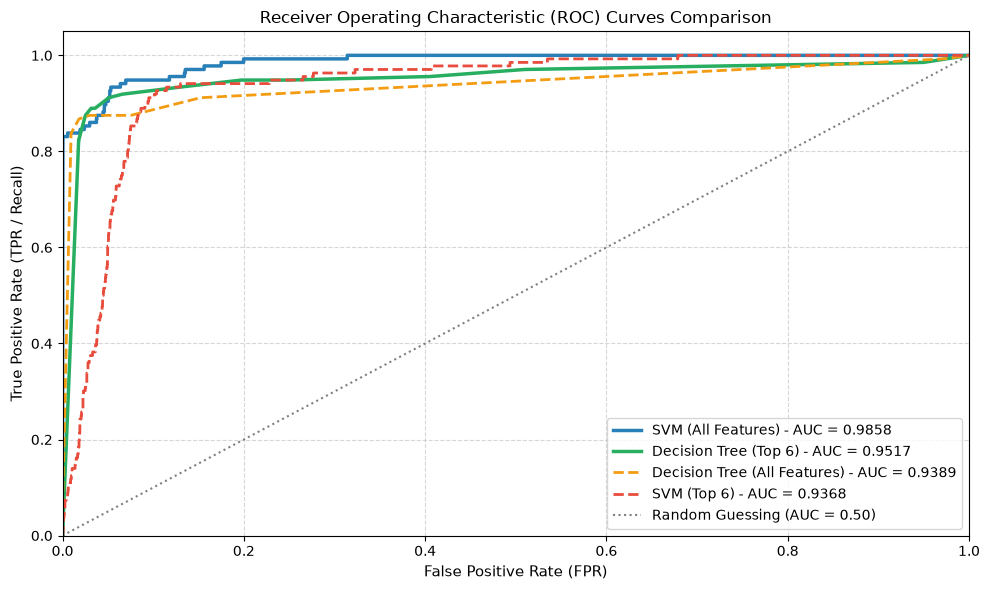

* **Lição de desbalanceamento no Notebook `07`:** Em fraudes (`99,83%` legítimas), acurácia engana completamente. Usar `compute_sample_weight('balanced')` (ou `class_weight='balanced'`) multiplica o peso da classe minoritária na função de custo, e avaliar com **ROC-AUC** revelou o **SVM (`0.986`)** aproveitando todas as 29 features melhor que uma árvore isolada (`0.952` após corte de features).

---

## 8. Ensembles: Random Forest (*Bagging*) vs. XGBoost (*Boosting*)

* **Notebook:** [09-Random-Forests-and-XGBoost.ipynb](./09-Random-Forests-and-XGBoost.ipynb)
* **Por que existem?** Uma Árvore de Decisão sozinha sofre de **alta variância**: mudar poucas linhas do dataset pode mudar completamente a árvore inteira. Combinar dezenas/centenas de árvores (*Ensemble Learning*) resolve isso de duas maneiras opostas:

| Aspecto | Random Forest (**Bagging**) | XGBoost (**Gradient Boosting**) |
| :--- | :--- | :--- |
| **Como treina** | Árvores profundas **independentes em paralelo** | Árvores rasas **em sequência (fila indiana)** |
| **Fonte de diversidade** | *Bootstrap* (amostragem com reposição) + subconjunto aleatório de colunas em cada split (`max_features`) | Cada nova árvore tenta prever o **erro residual / gradiente** deixado pela soma das anteriores |
| **O que reduz mais** | **Variância (Overfitting)** | **Viés (Underfitting)** e Variância (com `learning_rate` + regularização L1/L2 nas folhas) |
| **Sensibilidade a escala** | Não precisa escalar | Não precisa escalar |
| **Risco principal** | Pode ser pesado em memória se árvores forem gigantes | Pode dar *overfitting* se `n_estimators` ou `learning_rate` forem altos demais sem parada antecipada |

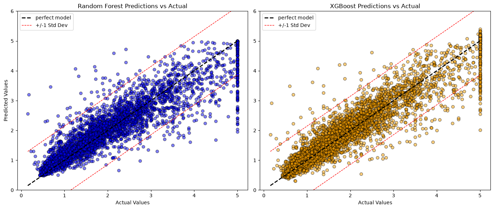

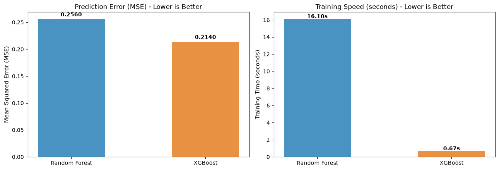

* No Notebook `09`, usando árvores pequenas e otimizadas, o **XGBoost** superou a **Random Forest** em precisão ($R^2 = 0.837$ vs $0.805$; MSE $0.214$ vs $0.256$) **e** treinou ~24x mais rápido (`0.67s` vs `16s`).

---

## 9. Regularização e Seleção Automática de Features: Ridge (L2) vs. Lasso (L1)

* **Notebook:** [14-Regularization-in-Linear-Regression.ipynb](./14-Regularization-in-Linear-Regression.ipynb)

### Qual problema a Regressão Comum (OLS) enfrenta em dados do mundo real?
Quando você tem **poucos exemplos e dezenas/centenas de variáveis correlacionadas ou inúteis** (como no experimento com `make_regression(n_samples=100, n_features=100, n_informative=10)`), ou quando existem **outliers extremos**, o `LinearRegression` tenta ajustar todos os coeficientes livres possíveis. Resultado: alguns pesos $w_j$ explodem para $+500$ enquanto outros vão para $-498$ tentando cancelar ruído no treino — causando **Overfitting grave**.

### A Solução: Colocar um "Freio no Tamanho dos Pesos" dentro da Função de Custo
Em vez de minimizar apenas o erro de previsão, somamos uma **multa proporcional ao tamanho dos coeficientes**, controlada pelo hiperparâmetro **`alpha` ($\alpha$)** (quanto maior `alpha`, mais forte o freio e menor o risco de *overfitting*, porém com risco de *underfitting* se exagerar):

1. **Ridge Regression — Regularização L2 (`Ridge(alpha=...)`):**
   $$\text{Custo}_{\text{Ridge}} = \text{MSE} + \alpha \sum_{j=1}^p w_j^2$$
   * **Como pensa:** Pune os pesos **ao quadrado**. Se um coeficiente for `10`, vira `100` na multa; se for `0.1`, vira `0.01`. Por isso, ela **aperta fortemente pesos gigantes** e divide o peso igualmente entre features correlacionadas (*multicolinearidade*), **mas quase nunca zera um coeficiente totalmente**.
   * **Quando usar:** quando muitas features contribuem um pouco e há multicolinearidade entre elas.

2. **Lasso Regression — Regularização L1 (`Lasso(alpha=...)`):**
   $$\text{Custo}_{\text{Lasso}} = \text{MSE} + \alpha \sum_{j=1}^p |w_j|$$
   * **Como pensa:** Pune o **valor absoluto**. Mesmo quando um peso já é pequeno, cada décimo dele ainda paga multa linear constante — empurrando pesos de variáveis fracas **exatamente para `0.0`**!
   * **Superpoder (Feature Selection Automática):** no Notebook `14`, em um espaço com 100 colunas onde só 10 importavam de verdade, o Lasso zerou dezenas de variáveis ruidosas e permitiu filtrar apenas as features realmente informativas (melhorando drasticamente o $R^2$ ao remover ruído!).

3. **Bônus — ElasticNet (`ElasticNet(alpha=..., l1_ratio=...)`):** mistura L1 + L2 para herdar seleção de variáveis do Lasso e estabilidade em grupos correlacionados do Ridge.

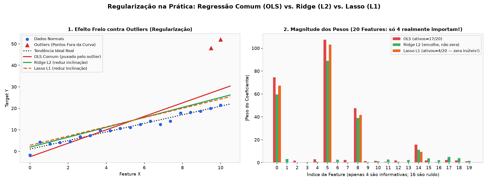

> [!CAUTION]
> **Regra de ouro em Ridge, Lasso e Regressão Logística com `penalty='l1'/'l2'`:**
> Você **precisa** usar `StandardScaler` antes! Como a penalidade soma os valores de $w_j$, uma variável medida em milímetros teria peso minúsculo e outra em quilômetros teria peso gigante só por causa da unidade, enganando a penalização.

---

## 10. Aprendizado Não Supervisionado — Clustering: K-Means vs. DBSCAN vs. HDBSCAN

* **Notebooks:** [10-K-Means-Clustering.ipynb](./10-K-Means-Clustering.ipynb), [11-DBSCAN-and-HDBSCAN-Clustering.ipynb](./11-DBSCAN-and-HDBSCAN-Clustering.ipynb), [17-Evaluating-K-Means-Clustering.ipynb](./17-Evaluating-K-Means-Clustering.ipynb)

Aqui **não existe coluna `y` (sem gabarito!)**. O objetivo é descobrir agrupamentos naturais diretamente na geometria dos dados (ex: segmentação de clientes no `Cust_Segmentation.csv` ou agrupamento geográfico de museus pelo Canadá).

### 10.1 K-Means — "Agrupamento por Centróides" (`10`)
* **Como funciona em 4 passos:**
  1. Sorteia $K$ centros iniciais (**`init="k-means++"`** espalha melhor esses pontos iniciais para não cair em mínimos locais ruins; `n_init=12` roda 12 tentativas e fica com a melhor!).
  2. Atribui cada ponto ao **centróide mais próximo** (distância Euclidiana).
  3. Recalcula cada centróide como a **média geométrica** dos pontos daquele grupo.
  4. Repete passos 2 e 3 até os centróides pararem de mexer.
* **O que ele minimiza?** A **Inércia / WCSS** (*Within-Cluster Sum of Squares*): soma das distâncias ao quadrado entre cada ponto e o seu centróide.
* **Os 3 defeitos estruturais do K-Means (que explicam por que DBSCAN/HDBSCAN existem!):**
  1. Você precisa **adivinhar o número `n_clusters` ($K$) antes**.
  2. Ele enxerga o mundo como **bolhas esféricas (Voronoi)** — se os dados formarem duas meias-luas ou anéis, ele corta ao meio errado!
  3. **Não sabe dizer "isso é um outlier"**: todo ponto esquisito é forçado para dentro de algum grupo, puxando o centróide para longe.

### 10.2 DBSCAN — "Agrupamento por Densidade" (`11`)
Ao invés de procurar centros esféricos, o **`DBSCAN(eps=..., min_samples=...)`** procura regiões onde há **muita gente aglomerada perto**:
* **`eps` ($\varepsilon$):** raio da vizinhança em volta de um ponto.
* **`min_samples`:** quantidade mínima de pontos dentro desse raio `eps` para formar um núcleo denso.
* Ele classifica todo ponto em 3 tipos:
  * **Core Point (Ponto Central):** tem pelo menos `min_samples` vizinhos dentro de `eps`.
  * **Border Point (Ponto de Borda):** tem poucos vizinhos, mas está dentro do raio de um *Core Point*.
  * **Noise / Outlier (Ruído = label `-1`):** está isolado no vazio $\rightarrow$ **não entra em cluster nenhum!**
* **Vantagens:** descobre $K$ sozinho, acompanha formatos malucos/curvos e isola outliers automaticamente.
* **Onde o DBSCAN trava?** Se você tem no mesmo dataset um cluster bem compacto (denso) e outro cluster mais espalhado (menos denso), **nenhum valor único de `eps` acerta os dois ao mesmo tempo**: um `eps` pequeno estilhaça o cluster aberto em vários microgrupos e ruído; um `eps` grande funde os dois grupos apertados em um só!

### 10.3 HDBSCAN — "DBSCAN Hierárquico Adaptativo" (`11`)
O **`HDBSCAN(min_cluster_size=..., min_samples=...)`** resolve justamente a limitação do `eps` fixo!
* Em vez de congelar um único raio `eps`, ele constrói uma **hierarquia completa de densidades** (conectando regiões do mais denso ao mais esparso, igual uma árvore de níveis do mar descendo) e seleciona automaticamente os clusters mais **estáveis e persistentes** ao longo da escala — **encontrando clusters com densidades bem diferentes no mesmo mapa** sem precisar calibrar `eps`!

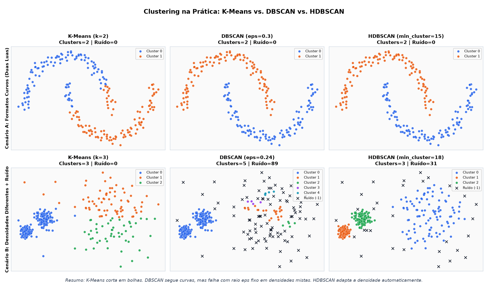

### 10.4 Como Dar Nota para Clustering Se Não Existe Gabarito `y`? (`17`)

Quando não há acurácia nem $R^2$, medimos **coesão interna** (pontos do mesmo grupo bem juntinhos) vs. **separação externa** (grupos bem longe entre si):

1. **Método do Cotovelo (*Elbow Method* com Inércia / WCSS):** Plotamos a Inércia para $k = 2, 3, 4, \dots$. Quanto mais clusters, menor a distância até os centros (com $k = N$, a Inércia é zero!). Procuramos o ponto de dobra ("cotovelo") onde adicionar novos clusters passa a dar ganho marginal mínimo.
2. **Silhouette Score (`silhouette_score` $\in [-1, +1]$):**
   Para cada ponto $i$, compara:
   * $a(i)$: distância média até os **colegas do mesmo cluster** (menor = grupo coeso).
   * $b(i)$: distância média até o **cluster vizinho mais próximo** (maior = grupo isolado).
   $$s(i) = \frac{b(i) - a(i)}{\max(a(i), b(i))}$$
   * Perto de **`+1.0`**: ponto perfeitamente encaixado no seu grupo e longe dos outros.
   * Perto de **`0.0`**: ponto bem na fronteira indecisa entre dois clusters.
   * **`< 0.0`**: ponto provavelmente colocado no cluster errado!
3. **Davies-Bouldin Index (`davies_bouldin_score`):** Calcula a razão entre a dispersão interna de cada cluster e a distância até o outro cluster mais parecido. **Quanto MENOR (mais perto de `0`), melhor**.
4. **Estabilidade (`17`):** Se você rodar o K-Means sem fixar `random_state` e os clusters mudarem muito de forma ou Inércia entre execuções, o `k` escolhido ou os dados não têm fronteiras naturais estáveis.

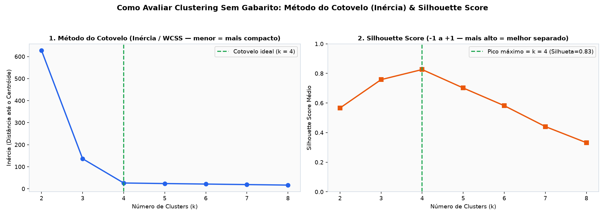

---

## 11. Redução de Dimensionalidade: PCA vs. t-SNE vs. UMAP

* **Notebooks:** [12-Principal-Component-Analysis-PCA.ipynb](./12-Principal-Component-Analysis-PCA.ipynb), [13-tSNE-and-UMAP-Dimensionality-Reduction.ipynb](./13-tSNE-and-UMAP-Dimensionality-Reduction.ipynb)

### Por que precisamos reduzir dimensões?
* **Maldição da Dimensionalidade (*Curse of Dimensionality*):** Quando você passa de 3 para 500 features, o volume do espaço explode e **quase todos os pontos ficam igualmente distantes entre si**, quebrando algoritmos baseados em distância (KNN, K-Means) e multiplicando o risco de *overfitting* e o tempo de treino.
* Além disso, humanos só enxergam em 2D e 3D!

### 11.1 PCA (*Principal Component Analysis*) — Projeção Linear Ortogonal (`12`)
Imagine segurar uma árvore 3D e girar uma lanterna até encontrar o ângulo onde a sombra dela na parede (2D) preserva **o máximo possível do tamanho e da forma original**:
* **PC1 (1º Componente Principal):** nova direção (combinação linear das colunas originais) ao longo da qual os dados têm a **maior variância possível**.
* **PC2 (2º Componente Principal):** direção perpendicular (**ortogonal, correlação zero!**) à PC1 que captura a maior parte da variância restante, e assim por diante.
* **No `sklearn`:** após rodar `StandardScaler()` (obrigatório para variáveis com escalas diferentes não monopolizarem a variância!), `pca.explained_variance_ratio_` diz quantos % da informação original cada componente carrega (por exemplo, reter componentes suficientes até somar **95% da variância explicada**).
* **Ponto forte:** Rápido, determinístico, reduz ruído/colinearidade e **aceita `.transform(X_test)`** dentro de `Pipeline` (como você fez no Notebook `18`!).
* **Limitação:** Por ser uma **rotação estritamente linear**, se as classes formam espirais, roscas ou camadas não-lineares, a sombra plana do PCA amassa grupos diferentes uns em cima dos outros!

### 11.2 t-SNE (*t-Distributed Stochastic Neighbor Embedding*) (`13`)
* **Como pensa:** Em vez de girar planos rígidos, o t-SNE calcula a probabilidade de dois pontos serem "vizinhos próximos" no espaço original (alta dimensão) e rearranja os pontos no mapa 2D para que **quem era vizinho lá em cima continue grudadinho aqui embaixo**.
* **Hiperparâmetro-chave (`perplexity`):** Controla o equilíbrio entre foco super-local vs. estrutura de vizinhança mais ampla (tipicamente entre `5` e `50`; no Notebook `13` usou `perplexity=30`).
* **Limitações severas:**
  1. **Não possui `.transform()` para dados novos** (não serve diretamente como pré-processador de inferência em produção; serve para **visualização exploratória / EDA**).
  2. **Tamanhos de clusters e distâncias globais entre ilhas distantes no t-SNE não são literais**: duas ilhas muito afastadas no 2D não estão necessariamente tão distantes no original!

### 11.3 UMAP (*Uniform Manifold Approximation and Projection*) (`13`)
* **Como pensa:** Constrói um grafo topológico de vizinhança (*fuzzy simplicial set* em variedades/manifolds) e otimiza o layout 2D usando descida estocástica.
* **Principais hiperparâmetros:**
  * `n_neighbors`: semelhante à perplexidade — valores baixos preservam microdetalhes locais; valores altos preservam a topologia global.
  * `min_dist` e `spread`: controlam quão apertados os pontos ficam dentro de cada cluster no gráfico.
* **Por que o mercado ama o UMAP?** Preserva muito bem a separação local **e** preserva melhor a relação global entre clusters do que o t-SNE, é **muito mais rápido** em datasets grandes **e implementa `.fit()` + `.transform()`**, podendo alimentar modelos em pipeline!

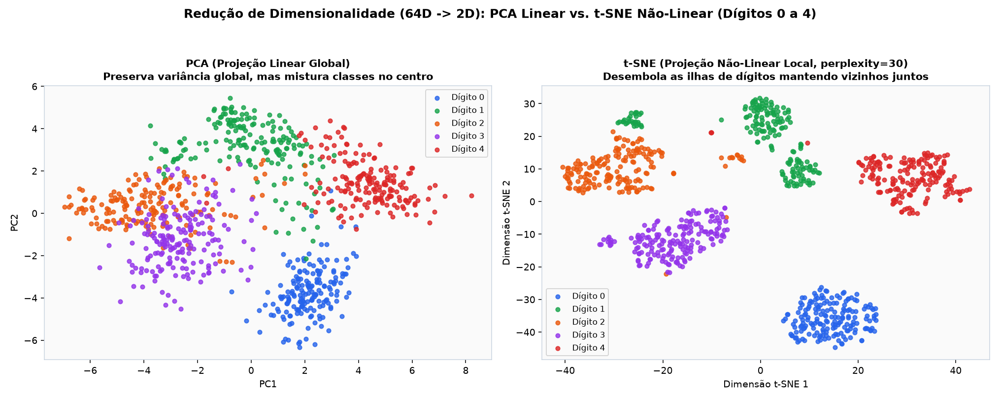

| Critério | PCA | t-SNE | UMAP |
| :--- | :---: | :---: | :---: |
| **Tipo de transformação** | Linear (rotação ortogonal) | Não-linear (*manifold*) | Não-linear (*manifold* / grafo) |
| **O que preserva** | Variância global | Vizinhanças locais | Vizinhanças locais + boa estrutura global |
| **Aceita novos dados (`.transform()`)?** | **Sim** (ótimo em `Pipeline`) | **Não** (só EDA/visualização) | **Sim** (uso exploratório e ML) |
| **Velocidade em datasets grandes** | Muito rápido | Lento ($O(N^2)$ / Barnes-Hut) | Rápido |
| **Reprodutibilidade sem seed** | Determinístico (único) | Estocástico (muda com seed) | Estocástico |

---

## 12. Avaliação Profunda & Engenharia de Produção (`15`–`20`)

### 12.1 Classificação Além da Acurácia (`15-Evaluating-Classification-Models.ipynb`)
No Notebook `15`, você classificou tumores de mama (`load_breast_cancer`) após injetar ruído artificial nas features, comparando **`KNeighborsClassifier(n_neighbors=5)`** vs **`SVC(kernel='linear', C=1)`**.

#### Os 4 Quadrantes da Matriz de Confusão
* **VP (Verdadeiro Positivo / TP):** tinha a doença (ou ia chover / era fraude) e o modelo **acertou** dizendo SIM.
* **VN (Verdadeiro Negativo / TN):** não tinha e o modelo **acertou** dizendo NÃO.
* **FP (Falso Positivo / Erro Tipo I — "Alarme Falso"):** não tinha, mas o modelo disse SIM (ex: cliente honesto bloqueado por engano; exame pede biópsia extra).
* **FN (Falso Negativo / Erro Tipo II — "Deixar Passar"):** **TINHA**, mas o modelo disse NÃO! No câncer, significa liberar paciente doente para casa achando que está saudável — **o erro de maior custo humano!**

#### As 4 Métricas Essenciais do `classification_report`
| Métrica | Fórmula | Tradução Direta | Quando priorizar? |
| :--- | :---: | :--- | :--- |
| **Precision** | $\frac{VP}{VP + FP}$ | *"Das vezes que disparei o alerta, quantas % eram reais?"* | Quando **Falso Positivo** custa caro (ex: filtro de spam marcando e-mail importante de trabalho; bloqueio agressivo de cliente VIP). |
| **Recall / Sensitivity (TPR)** | $\frac{VP}{VP + FN}$ | *"De todos os casos positivos que existiam de verdade, quantos % eu capturei?"* | Quando **Falso Negativo** é inaceitável (ex: triagem de câncer, fraude financeira, risco de chuva forte / alerta climático). |
| **F1-Score** | $2 \cdot \frac{\text{Precision} \cdot \text{Recall}}{\text{Precision} + \text{Recall}}$ | Média harmônica entre Precision e Recall (só fica alta se **ambas** forem boas!). | Quando há **classes desbalanceadas** e você precisa equilibrar alarmes falsos e casos perdidos. |
| **Specificity (TNR)** | $\frac{VN}{VN + FP}$ | *"De todos os casos sadios/negativos, quantos % eu liberei corretamente?"* | Saúde/diagnóstico para evitar falsos diagnósticos em massa. |

* **Diagnóstico Treino vs. Teste no Notebook `15`:** Comparar `classification_report` no **treino** vs **teste** em dados ruidosos mostrou a assinatura clássica de *Overfitting*: modelos muito locais como KNN podem acertar mais no treino decorando o ruído local e cair mais no teste, enquanto margens lineares regularizadas (`SVC(C=1)`) seguram melhor a generalização.
* **ROC-AUC vs. Precision-Recall AUC:**
  * A **Curva ROC** varia o limiar de probabilidade de `0.0` até `1.0` plotando `TPR (Recall)` vs `FPR (Taxa de Falso Alarme)`. `ROC-AUC = 1.0` é separação perfeita; `0.5` é moeda jogada para o alto.
  * Em datasets hiper-desbalanceados (como `0,17%` de fraude), muitos Falsos Negativos ou Positivos podem diluir o `FPR` porque `TN` é gigantesco — por isso olhar **`Precision-Recall AUC` + `Recall` da classe minoritária** nunca engana.

---

### 12.2 Avaliação em Regressão & Análise de Resíduos (`16-Evaluating-Random-Forest.ipynb`)
No Notebook `16` (*California Housing*, `RandomForestRegressor(n_estimators=100)`), o curso mostrou que **$R^2$ e MSE sozinhos escondem falhas graves**. É indispensável olhar para:
1. **Gráfico Real vs. Previsto (*Actual vs Predicted*):** idealmente todos os pontos abraçam a diagonal $y = \hat{y}$.
2. **Análise de Resíduos ($e_i = y_i - \hat{y}_i$):**
   * Um bom modelo produz resíduos distribuídos como um sino simétrico em zero (**ruído aleatório sem padrão**).
   * Se o gráfico mostra forma de funil (erro cresce para casas mais caras) ou uma linha diagonal cortada no teto (**clipping**: no California Housing, preços reais foram truncados em US\$ 500.000!), o modelo sofre viés sistemático nas faixas altas porque está tentando prever um teto artificial!
3. **Armadilha ao ler `feature_importances_`:** Quando duas features são fortemente colineares (como `Latitude`/`Longitude` juntas ou `MedInc` correlacionado a renda local), a Random Forest pode **dividir o crédito de importância entre elas**, fazendo variáveis geograficamente decisivas parecerem menores isoladamente.

---

### 12.3 Engenharia de Pipelines, `ColumnTransformer`, `StratifiedKFold` e `GridSearchCV` (`18`, `19`, `20`)

Nos três últimos laboratórios (`Iris` + `Titanic` + `Australian Weather Rainfall`), você montou a arquitetura profissional usada em produção e em competições reais para **zerar o risco de *Data Leakage*** e **automatizar o tuning**:

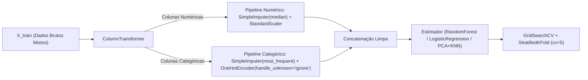

#### Anatomia de Produção (Baseada diretamente nos Notebooks `19` e `20`):

```python
from sklearn.compose import ColumnTransformer
from sklearn.pipeline import Pipeline
from sklearn.impute import SimpleImputer
from sklearn.preprocessing import StandardScaler, OneHotEncoder
from sklearn.ensemble import RandomForestClassifier
from sklearn.model_selection import StratifiedKFold, GridSearchCV

# 1. Pré-processamento específico por tipo de coluna (sem vazamento!)
numeric_transformer = Pipeline(steps=[
    ("imputer", SimpleImputer(strategy="median")),
    ("scaler", StandardScaler()),
])

categorical_transformer = Pipeline(steps=[
    ("imputer", SimpleImputer(strategy="most_frequent")),
    ("onehot", OneHotEncoder(handle_unknown="ignore")),
])

preprocessor = ColumnTransformer(transformers=[
    ("num", numeric_transformer, numeric_features),
    ("cat", categorical_transformer, categorical_features),
])

# 2. Pipeline completo: Pré-processamento -> Modelo
pipeline = Pipeline(steps=[
    ("preprocessor", preprocessor),
    ("classifier", RandomForestClassifier(random_state=42)),
])

# 3. Grade de Hiperparâmetros (usa prefixo 'step__parametro')
param_grid = {
    "classifier__n_estimators": [50, 100],
    "classifier__max_depth": [None, 10, 20],
    "classifier__min_samples_split": [2, 5],
}

# 4. Validação Cruzada Estratificada (mantém 76.3% / 23.7% em todos os folds!)
cv = StratifiedKFold(n_splits=5, shuffle=True, random_state=42)

# 5. GridSearchCV treina o preprocessor SÓ nos folds de treino a cada iteração!
grid = GridSearchCV(estimator=pipeline, param_grid=param_grid, cv=cv, scoring="accuracy", verbose=2)
grid.fit(X_train, y_train)
```

#### Por que essa arquitetura é ouro na prática? (Lições do Capstone `20`)
* **Sem *Data Leakage* na Cross-Validation:** Em cada uma das 5 dobras do `StratifiedKFold`, o `GridSearchCV` roda `preprocessor.fit_transform()` exclusivamente nas 4 dobras de treino e só aplica `.transform()` na dobra de validação. Nenhum dado de validação ou teste jamais contamina médias, modas, categorias ou escalas.
* **Engenharia de Features & Leakage no Australian Weather:**
  * Filtragem geográfica focada em Melbourne (`Melbourne`, `MelbourneAirport`, `Watsonia`) reduziu para **`7.557` registros limpos**.
  * Criação da feature cíclica `Season` a partir de `Date` para capturar sazonalidade climática sem memorizar datas exatas do passado.
  * **`OneHotEncoder(handle_unknown="ignore")`**: garante que, se surgir uma categoria inédita em produção (ou em algum fold de teste), a API não quebra com exceção.
* **Comparação Final Executada no Capstone (`1.512` amostras de teste):**
  * **`RandomForestClassifier` (tunado):** **84%** acurácia (`1.273 / 1.512`), **51% TPR / Recall** (`183 / 358` dias de chuva detectados), identificando **`Humidity3pm`** como preditor dominante.
  * **`LogisticRegression` (L1/L2 tunada):** **83%** acurácia (`1.252 / 1.512`), **51% TPR / Recall** (`182 / 358`).
  * **Conclusão de Engenharia:** Em dados desbalanceados (`76,3%` sem chuva / `23,7%` com chuva), embora a acurácia total seja alta (`83–84%`), um **Recall de 51% na classe positiva** revela o próximo passo natural em projetos reais: ajustar limiar de decisão (*threshold tuning*), usar `class_weight='balanced'` ou testar **XGBoost / Gradient Boosting** mirando especificamente elevar o Recall de dias chuvosos!

---

## 13. Dicionário "Tradutor de Prova & Entrevista Técnica" (Todos os 21 Tópicos)

Use esta tabela para traduzir instantaneamente o jargão técnico das provas da IBM e entrevistas de ML Engineer:

| Quando perguntarem ou descreverem... | Traduza mentalmente para... | Resposta Técnica Precisa |
| :--- | :--- | :--- |
| *"Alto erro no teste, erro quase zero no treino"* | Decorou o simulado + ruído! | **Overfitting / Alta Variância.** Solução: poda (`max_depth`), mais regularização (`alpha` maior ou `C` menor), `K` maior no KNN, ou menos features ruidosas. |
| *"Alto erro já nos dados de treino"* | Modelo simplório demais! | **Underfitting / Alto Viés.** Solução: modelo mais expressivo (polinomial, árvore mais profunda, XGBoost, Kernel RBF) ou novas features. |
| *"Qual modelo é um Lazy Learner / instance-based?"* | Não aprende nada no `.fit()`, só mede vizinhos na hora da prova | **KNN (K-Nearest Neighbors).** Exige `StandardScaler` e sofre em datasets gigantes na inferência. |
| *"Qual é a saída bruta da Regressão Logística antes do corte 0.5?"* | A saída da curva em "S" | Uma **probabilidade calibrada via função Sigmóide $\in (0, 1)$**, otimizada minimizando o **Log Loss**. |
| *"Como a Árvore escolhe onde dividir categorias vs números?"* | Quem organiza melhor as gavetas | Classificação: reduz **Gini** ou **Entropia** (maior *Information Gain*). Regressão: testa **Midpoints** e reduz **MSE / Variância** respondendo a **média** da folha. |
| *"Por que SVM resiste a pontos distantes?"* | Só olha para a primeira fila da divisa | Depende **apenas dos Vetores de Suporte** na borda da margem; pontos longe da fronteira têm peso zero na reta. |
| *"Para que serve o `epsilon` ($\varepsilon$) no SVR?"* | A largura do corredor sem multa | Define a **largura do tubo de tolerância ($\pm\varepsilon$)** onde desvios não são punidos. |
| *"Bagging (Random Forest) vs. Boosting (XGBoost)?"* | 100 corretores isolados vs. fila corrigindo o erro do anterior | **Bagging:** árvores paralelas votam para reduzir **Variância**. **Boosting:** árvores sequenciais corrigem resíduos para reduzir **Viés e Variância**. |
| *"Ridge (L2) vs. Lasso (L1)?"* | Aperto suave vs. tesoura que zera colunas | **Ridge (L2)** encolhe todos os pesos ($\sum w_j^2$), ótimo para colinearidade. **Lasso (L1)** usa $\sum \|w_j\|$ e **zera coeficientes** fracos (*Feature Selection*). |
| *"K-Means vs. DBSCAN vs. HDBSCAN?"* | Bolhas centradas vs. densidade fixa vs. densidade adaptativa | **K-Means:** exige $k$, assume bolhas esféricas, engole ruído. **DBSCAN:** segue curvas e marca ruído (`-1`), mas usa `eps` único. **HDBSCAN:** acha clusters com densidades diferentes sem `eps` global. |
| *"Como avaliar Clustering sem coluna `y`?"* | Medir se cada turma é apertada e longe das outras | **Elbow Method (Inércia)**, **Silhouette Score** ($-1$ a $+1$, maior é melhor) e **Davies-Bouldin Index** (menor é melhor). |
| *"PCA vs. t-SNE vs. UMAP?"* | Sombra linear vs. mapa de vizinhos para ver vs. grafo rápido transformável | **PCA:** linear, ordena variância explicada, vai em `Pipeline`. **t-SNE:** não-linear local (`perplexity`), só visualização (sem `.transform()`). **UMAP:** rápido, preserva local+global e aceita `.transform()`. |
| *"Precisão vs. Recall vs. F1-Score?"* | Certeza do alarme vs. não deixar doente/fraude escapar | **Precision:** evita Falso Positivo. **Recall (TPR):** evita Falso Negativo (crucial em câncer/fraude/chuva). **F1:** média harmônica equilibrando ambos. |
| *"Por que usar `Pipeline` + `ColumnTransformer` + `StratifiedKFold`?"* | Blindagem contra Data Leakage e código limpo | Garante que imputação, `StandardScaler`, `OneHotEncoder` e `PCA` ajustem estatísticas **exclusivamente nos folds de treino**, preservando a proporção das classes. |
| *"Quais modelos OBRIGATORIAMENTE exigem `StandardScaler`?"* | Modelos que medem distância ou somam magnitude de peso | **KNN, SVM/SVR, K-Means, DBSCAN/HDBSCAN, PCA, t-SNE/UMAP, Ridge, Lasso e Regressão Logística.** *(Árvores, Random Forest e XGBoost **NÃO** exigem!)*. |

---

## 14. Bússola Rápida: Qual Algoritmo Escolher na Vida Real?

1. **Você tem a resposta certa (`y`) para treinar?**
   * **NÃO** → Aprendizado Não Supervisionado:
     * *Quer agrupar registros semelhantes?* → `K-Means` (grupos compactos e redondos + Elbow/Silhueta) ou `DBSCAN / HDBSCAN` (formas livres, mapas geográficos, detecção de outliers).
     * *Quer comprimir colunas / acelerar pipeline mantendo variância linear?* → `StandardScaler + PCA`.
     * *Quer visualizar clusters complexos 50D+ em 2D?* → `UMAP` (ou `t-SNE`).
   * **SIM** → Aprendizado Supervisionado:
     * **Alvo Numérico (Regressão):**
       * Baseline interpretável → `LinearRegression` (ou `Ridge` / `Lasso` se houver muitas features colineares/ruído).
       * Máxima precisão tabular → `RandomForestRegressor` ou `XGBRegressor` (sempre checando análise de resíduos e RMSE!).
     * **Alvo Categórico (Classificação):**
       * Baseline rápido e probabilidades interpretáveis → `StandardScaler + LogisticRegression` (`OvO` ou `Multinomial` se multiclasse ordinal/complexa).
       * Regras claras para negócio → `DecisionTreeClassifier` (podada via `max_depth`).
       * Alta dimensão com poucas amostras → `StandardScaler + SVC` (`kernel='rbf'` ou `'linear'`).
       * Melhor desempenho padrão em tabelas mistas → `ColumnTransformer + RandomForestClassifier / XGBClassifier` dentro de **`Pipeline` + `StratifiedKFold` + `GridSearchCV`**.

---

## 15. Gabarito Comentado do Quiz Oficial da IBM (As 7 Questões do Teste)

Não se sinta mal por ter achado o teste desafiador! As provas de certificação da IBM adoram colocar pegadinhas sutis de vocabulário e contexto prático em inglês. 

Abaixo está a dissecação completa de cada uma das 7 perguntas, com o raciocínio prático sem complicações, o porquê da alternativa correta e onde estava a "casca de banana" de cada questão.

---

### Questão 1: Previsão de Cancelamento de Clientes (Churn em Telecom)

> **Enunciado Original:**
> *A telecom company uses past customer behavior to predict service cancellations. Which model should they use for this classification task?*
> 
> * Naïve Bayes
> * K-nearest neighbors
> * **Decision trees** ✅ *(Resposta Correta)*
> * Neural networks

#### 🔍 O que a questão está perguntando na prática?
Uma empresa de telecomunicações quer usar o histórico comportamental dos clientes (ex: tempo de assinatura, tipo de plano, fatura mensal, chamadas de suporte) para prever quem vai **cancelar o serviço (Churn)**. Qual modelo de classificação é o mais adequado para essa tarefa?

#### 💡 Por que a resposta é **Decision trees (Árvores de Decisão)**?
1. **Regras Claras e Acionáveis:** O comportamento de cancelamento em operadoras é orientado por regras de corte lógicas (*"SE o contrato for mês a mês E o cliente fez mais de 3 reclamações no suporte, ENTÃO o risco de cancelamento é 85%"*). Árvores de Decisão extraem exatamente essas regras no formato de fluxograma visual.
2. **Interpretabilidade para Negócios:** O time de retenção e produto da operadora precisa **entender o motivo** do cancelamento para poder agir (ex: oferecer desconto ou trocar roteador para quem caiu naquele nó específico).
3. **Dados Heterogêneos (Mistura de números e categorias):** Em telecomunicações, temos tabelas com colunas numéricas (meses de conta, gasto financeiro) e colunas categóricas (tipo de plano, forma de pagamento). Árvores lidam com isso de forma direta e natural, sem exigir escalonamento prévio.

#### ⚠️ Por que as outras alternativas estão incorretas?
* **Naïve Bayes:** Assume a premissa de que todas as características são estatisticamente independentes entre si. Em telecom isso é irreal: o valor da fatura está diretamente ligado ao plano contratado e ao uso de serviços adicionais.
* **K-nearest neighbors (KNN):** Em operadoras com centenas de milhares de clientes, o KNN se torna lento demais para predição em tempo real e perde eficácia quando há muitas variáveis categóricas sem distância geométrica natural.
* **Neural networks:** Excessivamente complexas, custosas de treinar e funcionam como uma "caixa-preta", o que dificulta explicar para os gestores da empresa *por que* um cliente foi classificado como provável cancelador.

---

### Questão 2: Critério de Desempate no One-vs-One (OvO)

> **Enunciado Original:**
> *In a one-versus-one classification approach, how can the final class label be decided in case of a tie?*
> 
> * Sequential selection
> * Random selection
> * **Probability weighing** ✅ *(Resposta Correta)*
> * Majority vote

#### 🔍 O que a questão está perguntando na prática?
Quando usamos a estratégia **One-vs-One (OvO)** para classificar várias classes (duelos 1 contra 1), como é decidida a classe final vencedora **em caso de empate**?

#### 💡 Por que a resposta é **Probability weighing (Ponderação por Probabilidade)**?
* **A Armadilha da Questão:** Quase todo mundo bate o olho e pensa logo em *Majority vote (Votação por maioria)*! **Mas atenção ao enunciado:** ele perguntou o que fazer **"in case of a tie" (no caso de EMPATE)**!
* **A lógica do método:** O *Majority vote* é a regra primária (quem tiver mais vitórias nos confrontos diretos ganha). Porém, se a **Classe A** e a **Classe B** terminarem com exatamente o mesmo número de vitórias (ex: empate de 3 a 3), a contagem simples de votos não consegue desempatar.
* **O critério de desempate:** O modelo então recorre à **força / probabilidade** de cada vitória. Ele soma as probabilidades contínuas ou distâncias de margem (`decision_function` ou `predict_proba`) emitidas pelos modelos individuais. A classe que acumulou a maior probabilidade ou nível de confiança combinada vence o desempate!

#### ⚠️ Por que as outras alternativas estão incorretas?
* **Majority vote:** É o processo geral da primeira fase, mas **é justamente ele que produziu o empate**! Não tem como o empate ser resolvido por quem causou o empate.
* **Random selection:** Escolher na moeda (sorteio) tornaria as previsões imprevisíveis e sem reprodutibilidade; é apenas um último recurso de emergência caso até as probabilidades ponderadas empatem exatamente.
* **Sequential selection:** Escolher arbitrariamente a primeira classe por ordem alfabética ou de índice seria um viés sem critério estatístico.

---

### Questão 3: O que a Entropia Mede na Árvore de Decisão?

> **Enunciado Original:**
> *Alice is building a decision tree and wants to evaluate how mixed data is mixed at each node. What does this measure represent in terms of entropy in a decision tree?*
> 
> * **The level of disorder or randomness in a node** ✅ *(Resposta Correta)*
> * The total count of final decision nodes
> * The average value of a feature in the dataset
> * The number of the tree's depth from root to leaf

#### 🔍 O que a questão está perguntando na prática?
Alice está construindo uma árvore de decisão e quer avaliar o quão misturados os dados estão dentro de cada nó. O que essa medida representa quando falamos de **Entropia**?

#### 💡 Por que a resposta é **The level of disorder or randomness in a node (O nível de desordem ou aleatoriedade em um nó)**?
* **Conceito Fundamental:** Na Teoria da Informação (Shannon) e na física, a palavra **Entropia** é literalmente a medida matemática do **grau de desordem, incerteza ou aleatoriedade**.
* **Na Árvore de Decisão:**
  * Se um nó contém 50 pacientes do Remédio A e 50 do Remédio B, a incerteza é total → **Entropia Máxima (1.0)**.
  * Se a árvore faz uma pergunta que divide perfeitamente o grupo e entrega um nó onde todos os 100 pacientes tomam o Remédio Y, acabou qualquer dúvida → **Entropia Zero (0.0 — nó 100% puro)**.
* Portanto, calcular a entropia é exatamente medir o **nível de desordem e mistura dos dados no nó**.

#### ⚠️ Por que as outras alternativas estão incorretas?
* *The total count of final decision nodes:* Isso é o número de folhas (*leaves*).
* *The average value of a feature:* Isso é apenas a média estatística de uma variável.
* *The number of the tree's depth:* Isso é a profundidade máxima da árvore (`max_depth`).

---

### Questão 4: Como a Árvore de Regressão Corta Variáveis Contínuas?

> **Enunciado Original:**
> *A data scientist splits a continuous feature using thresholds between consecutive sorted values. Which method is being used to determine candidate splits in this regression tree?*
> 
> * Exhaustive search method
> * Mean squared error (MSE) method
> * Entropy reduction method
> * **Midpoints method** ✅ *(Resposta Correta)*

#### 🔍 O que a questão está perguntando na prática?
Um cientista de dados está dividindo uma característica contínua (ex: Idade, Preço) criando limites de corte entre valores consecutivos ordenados. Qual método está sendo usado para determinar os **candidatos a corte** nessa árvore de regressão?

#### 💡 Por que a resposta é **Midpoints method (Método dos Pontos Médios)**?
* **Como a Árvore testa onde cortar variáveis numéricas:**
  1. A árvore pega todos os valores distintos observados naquela coluna e coloca em ordem crescente (ex: `10, 20, 30, 40`).
  2. Para criar as perguntas de divisão (Sim ou Não), ela calcula o **ponto médio (midpoint)** entre cada par consecutivo:
     * Entre 10 e 20 → ponto de corte candidato: `15`
     * Entre 20 e 30 → ponto de corte candidato: `25`
     * Entre 30 e 40 → ponto de corte candidato: `35`
  3. Essa técnica de gerar os potenciais limiares de corte pela média de valores vizinhos ordenados chama-se **Midpoints method**.

#### ⚠️ Por que as outras alternativas estão incorretas?
* **Mean squared error (MSE) method:** O MSE é a **métrica de custo/erro** usada para avaliar a qualidade de um corte já gerado, mas **não é o método geométrico que gera os candidatos a corte**.
* **Entropy reduction method:** Entropia só existe em árvores de **classificação** (categorias); em regressão numérica, usamos redução de variância / MSE.
* **Exhaustive search method:** É um termo abrangente para descrever que o algoritmo avalia todas as opções disponíveis, mas o método específico para estabelecer os valores dos limites entre números contínuos é o cálculo dos pontos médios.

---

### Questão 5: O Efeito de um Valor Alto de K no KNN

> **Enunciado Original:**
> *A company uses K-nearest neighbors (KNN) to predict customers' interest in a new product. What would happen if they chose a high K value?*
> 
> * The training time for the model increases.
> * **The model may underfit the data.** ✅ *(Resposta Correta)*
> * The model may predict more.
> * The model becomes specific.

#### 🔍 O que a questão está perguntando na prática?
Uma empresa usa KNN para prever o interesse de clientes em um novo produto. O que acontece se ela escolher um valor de K (número de vizinhos) **muito elevado**?

#### 💡 Por que a resposta é **The model may underfit the data (O modelo pode sofrer subajuste / underfitting)**?
* **A Analogia Prática da Votação:**
  * Se $K = 1$ (muito pequeno): O modelo consulta apenas 1 vizinho. Se aquele vizinho tiver um gosto atípico, o modelo é enganado facilmente (**Overfitting** / Alta Variância).
  * Se $K$ for **muito alto** (por exemplo, consultar 800 vizinhos num banco de 1.000 clientes): O modelo não está mais olhando para os gostos locais de quem é parecido; ele está basicamente consultando a população inteira! A resposta será sempre a classe majoritária geral, ignorando os padrões específicos de cada nicho.
* **Consequência:** A fronteira de decisão fica excessivamente reta e generalista demais, incapaz de capturar os padrões reais dos dados → **Underfitting (Subajuste / Alto Viés)**.

#### ⚠️ Por que as outras alternativas estão incorretas?
* *The training time for the model increases:* O KNN é um *Lazy Learner* (aprendiz preguiçoso), ou seja, **não tem tempo de treino** (ele apenas armazena os dados na memória). O que aumenta com K alto é o tempo de cálculo durante a predição.
* *The model becomes specific:* Ocorre o exato oposto: o modelo se torna **excessivamente genérico**, perdendo qualquer especificidade.
* *The model may predict more:* Não possui significado matemático em machine learning; o modelo continua prevendo uma única classe por registro.

---

### Questão 6: O Parâmetro Épsilon (ε) no Support Vector Regression (SVR)

> **Enunciado Original:**
> *Rommy is using support vector regression (SVR) to predict housing prices. He adjusts the epsilon (ε) value and notices that more data points are falling outside the shaded prediction band. What does this change in epsilon represent?*
> 
> * It affects how features are scaled in input space.
> * It increases the number of support vectors used.
> * It modifies the kernel function used for transformation.
> * **It changes the width of the margin around the predicted curve.** ✅ *(Resposta Correta)*

#### 🔍 O que a questão está perguntando na prática?
Rommy está usando SVR (Regressão por Vetores de Suporte) para prever preços de imóveis. Ele ajusta o valor de **épsilon (ε)** e nota que **mais pontos estão ficando fora da faixa sombreada de previsão**. O que essa mudança no épsilon representa diretamente?

#### 💡 Por que a resposta é **It changes the width of the margin around the predicted curve (Muda a largura da margem ao redor da curva prevista)**?
* **O Tubo de Tolerância do SVR (ε-tube):**
  * Na regressão SVR, o algoritmo constrói uma "faixa de tolerância" (banda sombreada) ao redor da curva de previsão.
  * O parâmetro **ε (épsilon)** define explicitamente a **largura ou raio dessa margem de tolerância**:
    * Se ε for amplo, a margem é larga e pontos próximos da linha têm erro desconsiderado (penalidade zero).
    * Se Rommy **reduz o ε**, a margem encolhe e fica mais estreita. Consequentemente, **mais pontos caem para fora da faixa sombreada**, passando a sofrer penalidade de erro.
* Portanto, alterar o ε altera essencialmente a **largura da margem de tolerância**.

#### ⚠️ Por que as outras alternativas estão incorretas?
* *It affects how features are scaled:* O escalonamento de features é realizado por transformadores de dados como `StandardScaler`, e não por parâmetros internos do SVR.
* *It modifies the kernel function:* A função de kernel é escolhida via hiperparâmetro `kernel` (`'linear'`, `'rbf'`, `'poly'`).
* *It increases the number of support vectors used:* Embora o aumento de pontos fora do tubo faça com que mais observações se tornem vetores de suporte, essa é uma **consequência indireta**, enquanto o que o ε controla diretamente em sua definição é a **largura da margem**.

---

### Questão 7: A Consequência de um Alto Viés (*High Bias*) no Modelo

> **Enunciado Original:**
> *Your team is evaluating the model and has identified that it makes inaccurate predictions even on the training data and seems too simple. What is the consequence of high bias in a model?*
> 
> * **The model performs poorly on training data due to oversimplification.** ✅ *(Resposta Correta)*
> * The model is sensitive to noise in the training data.
> * The model tends to overfit the training data for predictions.
> * The model performs well on both training and testing datasets.

#### 🔍 O que a questão está perguntando na prática?
Sua equipe está avaliando um modelo e constatou que ele erra as previsões **até mesmo nos dados de treino** e aparenta ser **simples demais**. Qual é a consequência direta do **alto viés (*high bias*)** em um modelo?

#### 💡 Por que a resposta é **The model performs poorly on training data due to oversimplification (O modelo tem desempenho ruim nos dados de treino devido à supersimplificação)**?
* **O Dilema Viés vs. Variância (*Bias-Variance Tradeoff*):**
  * **Alto Viés (*High Bias*) = Subajuste (*Underfitting*):** O modelo é ingênuo e simplista demais (por exemplo, insistir em passar uma linha reta rígida em dados que formam parábolas ou círculos). Por não ter flexibilidade suficiente para aprender a estrutura básica do problema, ele **apresenta alto erro já nos dados de treino**.
  * **Alta Variância (*High Variance*) = Sobreajuste (*Overfitting*):** O oposto. O modelo é complexo em excesso, decora o ruído e vai excepcionalmente bem no treino, mas erra no teste.
* Como o enunciado relata expressamente que o modelo comete erros nos dados de treino por ser simples demais, estamos diante da definição padrão de **Underfitting por supersimplificação**.

#### ⚠️ Por que as outras alternativas estão incorretas?
* *The model is sensitive to noise in the training data:* Característica clássica de **Alta Variância (Overfitting)**, exatamente o oposto de alto viés.
* *The model tends to overfit the training data:* Alto viés impede o modelo até de se ajustar ao treino, portanto não há como causar overfitting.
* *The model performs well on both datasets:* Isso descreve um modelo equilibrado e bem ajustado, não um modelo com alto viés problemático.

---

### 📋 Tabela Resumo: Para Gabaritar nas Próximas Tentativas!

| Questão | Tema Central | Pista no Enunciado | Resposta Correta | Regra Prática de Memorização |
| :---: | :---: | :---: | :---: | :--- |
| **Q1** | Modelo para Churn | *Customer behavior to predict service cancellations* | **Decision trees** | Cancelamento em telecom = Regras de corte lógicas, acionáveis e interpretáveis. |
| **Q2** | Multiclasse OvO | *Decided in case of a tie* | **Probability weighing** | Maioria elege no início, mas **empate se resolve somando a probabilidade** contínua. |
| **Q3** | Entropia | *How mixed data is mixed at each node* | **Level of disorder or randomness** | Entropia em ciências exatas e IA é sempre **medida de desordem ou incerteza**. |
| **Q4** | Árvore de Regressão | *Thresholds between consecutive sorted values* | **Midpoints method** | Cortes numéricos contínuos = Médias calculadas entre vizinhos adjacentes (**Midpoints**). |
| **Q5** | Hiperparâmetro KNN | *High K value* | **Underfit the data** | $K$ gigante consulta todo mundo → Fronteira fica genérica demais (**Underfitting**). |
| **Q6** | SVR | *Epsilon (ε) value / shaded prediction band* | **Width of the margin around predicted curve** | $\varepsilon$ define a **largura do tubo de tolerância** ao redor da curva de regressão. |
| **Q7** | Conceito de Viés | *High bias / too simple / inaccurate on training* | **Poorly on training data due to oversimplification** | Alto Viés (*Bias*) = Modelo simplório → **Erra até no próprio Treino (Underfitting)**. |
