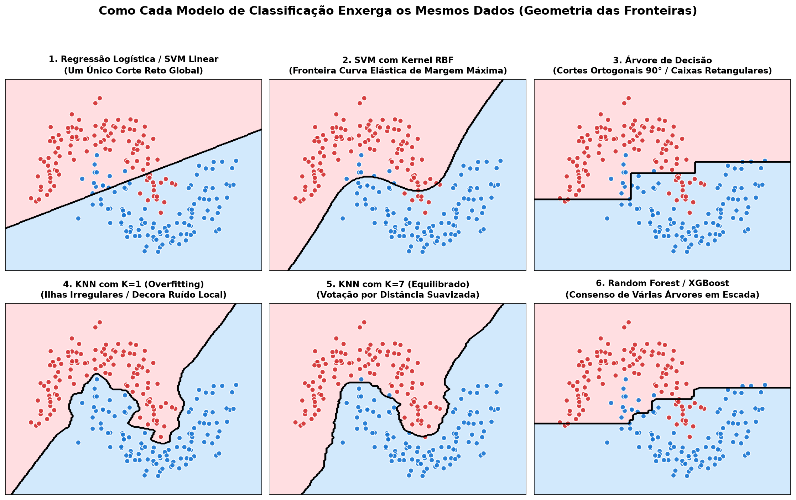
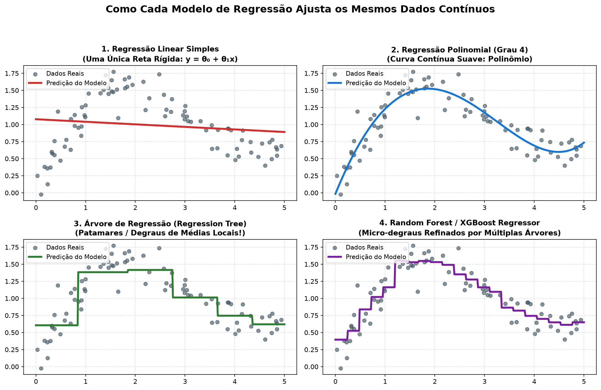

# Machine Learning with Python — IBM AI Engineering

Labs, practical exercises, study guide, and the final capstone project for the **Machine Learning with Python** course (part of the IBM AI Engineering Professional Certificate).

> 📘 **Study Guide & Visual Explanations (PT-BR):** Read the complete didactic guide with plots, intuitions, and annotated quiz review in **[Estudos.md](./Estudos.md)**.

---

## 📂 Repository Contents

### 1. Supervised Learning — Regression & Classification
| # | Notebook | Topic / Dataset |
| :---: | :--- | :--- |
| `01` | [01-Simple-Linear-Regression.ipynb](./01-Simple-Linear-Regression.ipynb) | Simple Linear Regression (`CO₂` emissions) |
| `02` | [02-Multiple-Linear-Regression.ipynb](./02-Multiple-Linear-Regression.ipynb) | Multiple & Polynomial Linear Regression |
| `03` | [03-Logistic-Regression.ipynb](./03-Logistic-Regression.ipynb) | Binary Classification — Telco Customer Churn |
| `04` | [04-Multi-Class-Classification.ipynb](./04-Multi-Class-Classification.ipynb) | Multi-Class Classification (OvR vs. OvO) — Obesity Risk |

### 2. Trees, Neighbors, Margins & Ensembles
| # | Notebook | Topic / Dataset |
| :---: | :--- | :--- |
| `05` | [05-Decision-Trees.ipynb](./05-Decision-Trees.ipynb) | Decision Tree Classification — Drug Prescription |
| `06` | [06-Regression-Trees.ipynb](./06-Regression-Trees.ipynb) | Decision Tree Regression — NYC Taxi Tips |
| `07` | [07-Support-Vector-Machines.ipynb](./07-Support-Vector-Machines.ipynb) | Decision Trees vs. SVM — Credit Card Fraud Detection |
| `08` | [08-K-Nearest-Neighbors.ipynb](./08-K-Nearest-Neighbors.ipynb) | K-Nearest Neighbors (KNN) Classification |
| `09` | [09-Random-Forests-and-XGBoost.ipynb](./09-Random-Forests-and-XGBoost.ipynb) | Random Forest vs. XGBoost Performance Comparison |

### 3. Unsupervised Learning — Clustering & Dimensionality Reduction
| # | Notebook | Topic / Dataset |
| :---: | :--- | :--- |
| `10` | [10-K-Means-Clustering.ipynb](./10-K-Means-Clustering.ipynb) | K-Means Customer Segmentation |
| `11` | [11-DBSCAN-and-HDBSCAN-Clustering.ipynb](./11-DBSCAN-and-HDBSCAN-Clustering.ipynb) | Density-Based Clustering: DBSCAN vs. HDBSCAN |
| `12` | [12-Principal-Component-Analysis-PCA.ipynb](./12-Principal-Component-Analysis-PCA.ipynb) | Dimensionality Reduction with PCA |
| `13` | [13-tSNE-and-UMAP-Dimensionality-Reduction.ipynb](./13-tSNE-and-UMAP-Dimensionality-Reduction.ipynb) | Nonlinear Dimensionality Reduction: t-SNE vs. UMAP |

### 4. Regularization, Evaluation & Pipelines
| # | Notebook | Topic / Dataset |
| :---: | :--- | :--- |
| `14` | [14-Regularization-in-Linear-Regression.ipynb](./14-Regularization-in-Linear-Regression.ipynb) | Ridge, Lasso & Regularization Techniques |
| `15` | [15-Evaluating-Classification-Models.ipynb](./15-Evaluating-Classification-Models.ipynb) | Classification Metrics & Confusion Matrices |
| `16` | [16-Evaluating-Random-Forest.ipynb](./16-Evaluating-Random-Forest.ipynb) | Random Forest Model Evaluation |
| `17` | [17-Evaluating-K-Means-Clustering.ipynb](./17-Evaluating-K-Means-Clustering.ipynb) | Silhouette Score, Inertia & Clustering Validation |
| `18` | [18-ML-Pipelines-and-GridSearchCV.ipynb](./18-ML-Pipelines-and-GridSearchCV.ipynb) | Scikit-Learn Pipelines & Hyperparameter Tuning |

### 5. Practice & Final Capstone Project
| # | Notebook | Topic / Dataset |
| :---: | :--- | :--- |
| `19` | [19-Practice-Project-Titanic-Survival.ipynb](./19-Practice-Project-Titanic-Survival.ipynb) | Practice Project: Titanic Survival Prediction |
| `20` | [20-Final-Project-Australian-Rainfall-Classifier.ipynb](./20-Final-Project-Australian-Rainfall-Classifier.ipynb) | **Final Project:** Australian Weather Rainfall Classifier (Melbourne area) |

---

## 🏆 Final Project Highlight (`20-Final-Project-Australian-Rainfall-Classifier.ipynb`)

Built an end-to-end rainfall prediction pipeline for the Melbourne metropolitan region (`7,557` cleaned records across Melbourne, Melbourne Airport, and Watsonia) addressing data leakage and class imbalance (`76.3%` No / `23.7%` Yes):

* **Pipeline & Optimization:** `ColumnTransformer` (`StandardScaler` + `OneHotEncoder`) paired with `StratifiedKFold` cross-validation and `GridSearchCV`.
* **Model Comparison (1,512 test samples):**
  * **Random Forest Classifier:** **84%** accuracy (`1,273` correct predictions), **51%** true positive rate (`183/358`), top predictor: `Humidity3pm`.
  * **Logistic Regression:** **83%** accuracy (`1,252` correct predictions), **51%** true positive rate (`182/358`).

---

## 🖼️ Visual Model Intuition

