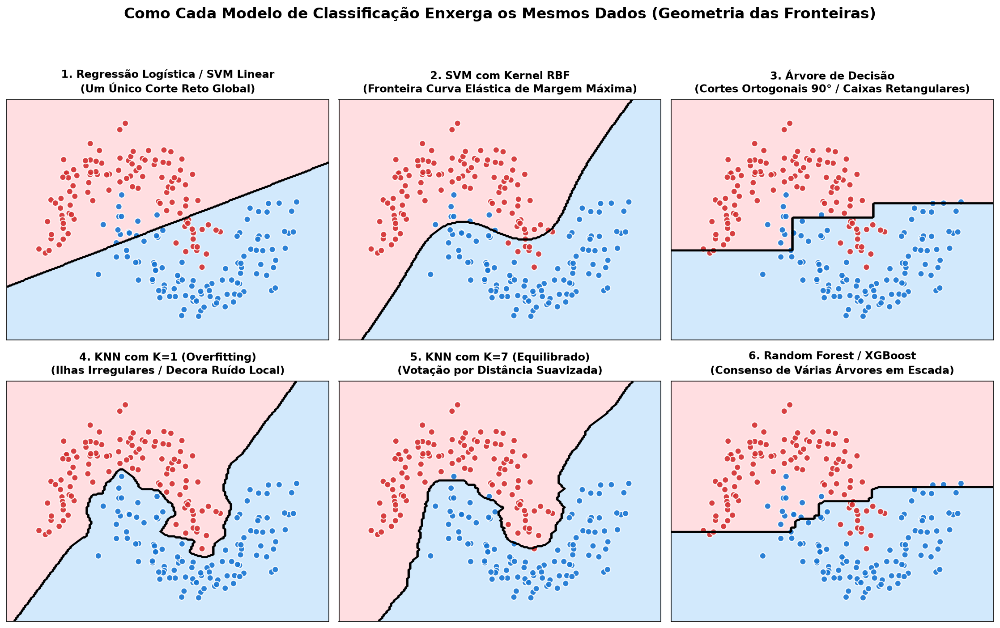

# IBM AI Engineering Professional Certificate — Portfolio & Study Labs

This repository gathers all hands-on labs, Jupyter notebooks, visual study guides, and capstone projects completed throughout the **IBM AI Engineering Professional Certificate** track.

Each course module is organized into its own dedicated directory with standardized, sequentially numbered notebooks (`01` to `N`).

---

## 📚 Course Modules

| Module | Directory | Status | Key Highlights |
| :--- | :--- | :---: | :--- |
| **Machine Learning with Python** | [Machine-Learning-with-Python/](./Machine-Learning-with-Python/) | ✅ Completed | 20 standardized notebooks covering Supervised & Unsupervised ML, Pipelines, `GridSearchCV`, [Didactic Study Guide (PT-BR)](./Machine-Learning-with-Python/Estudos.md), and [Australian Weather Rainfall Capstone](./Machine-Learning-with-Python/20-Final-Project-Australian-Rainfall-Classifier.ipynb). |
| *Upcoming Modules* | *(Deep Learning, PyTorch, Keras, GenAI, RAG, Agents...)* | 🚧 In Progress | Directories will be added progressively as each module is completed. |

---

## 🚀 Highlighted Module: [Machine Learning with Python](./Machine-Learning-with-Python/)

* **20 Structured Notebooks (`01`–`20`):** Linear/Logistic Regression, OvR vs. OvO Multi-class, Decision & Regression Trees, SVM, KNN, Random Forest & XGBoost, K-Means, DBSCAN/HDBSCAN, PCA, t-SNE/UMAP, Regularization, Model Evaluation, Scikit-Learn Pipelines, Practice & Capstone Projects.
* **Master Study Guide & Visual Intuition:** [Estudos.md](./Machine-Learning-with-Python/Estudos.md) — intuitive explanations with generated notebook plots and custom decision boundary comparisons.
* **Final Capstone (`20`):** Rainfall prediction classifier for Australian weather observations (Melbourne region), comparing tuned `RandomForestClassifier` (**84%** test accuracy) and `LogisticRegression` (**83%** test accuracy) inside a `ColumnTransformer` + `GridSearchCV` pipeline.

